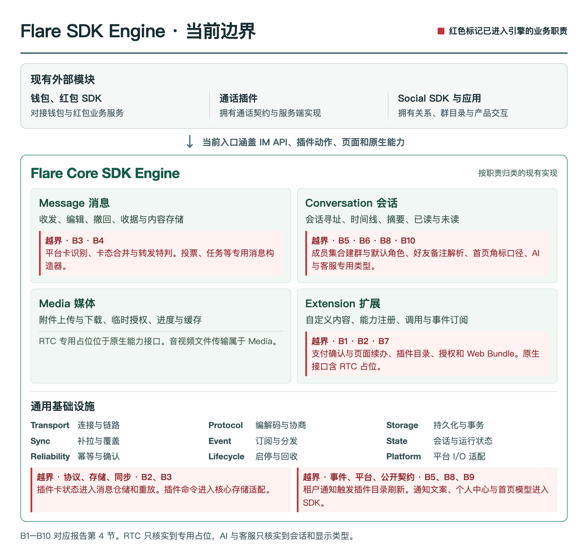
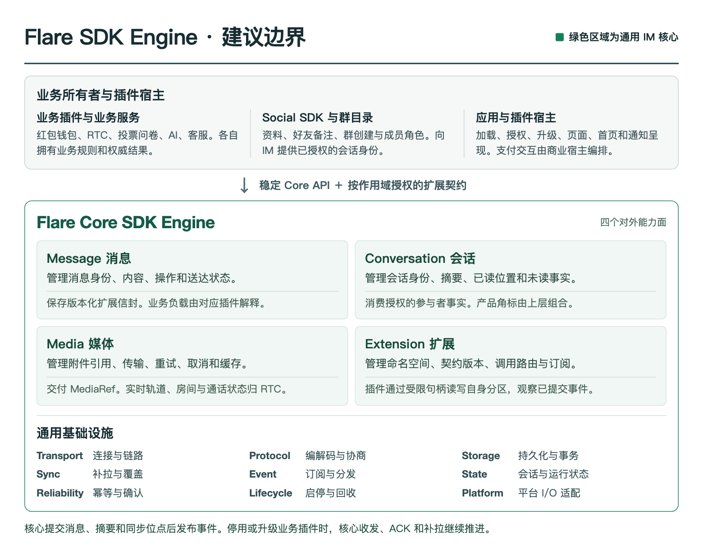
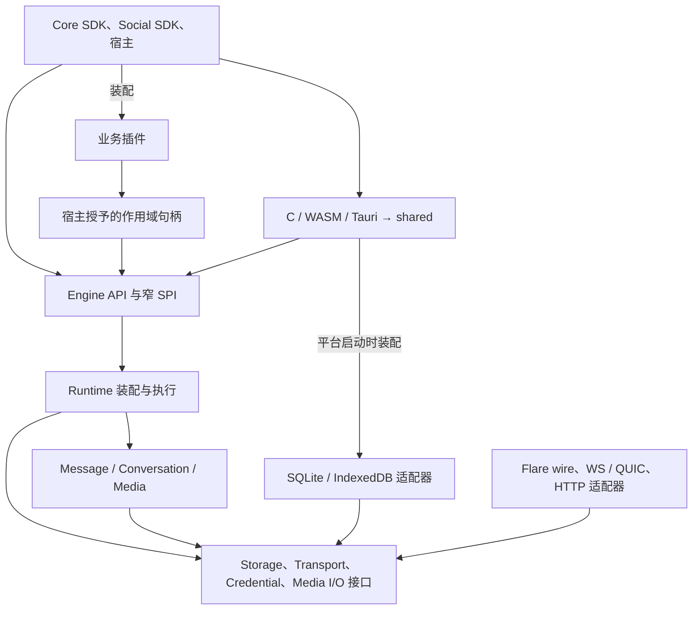

# Flare Core SDK Engine 全面能力审计与开放式核心架构设计

**审计基线**　2026-11-25，仓库 `dev`，HEAD `371150641d68c3b27e9f9d4ce6e5db4e576bf99d`，以本地工作区源码为准。开始时有 37 个已有变更，主要涉及直接接入后的升级模块移除及契约调整。审计期间已有并行修改同步了 12 个生成文件，下文注明观察时点与检查结果。本文只交付审计与设计。

## 1. 结论与优先级

本报告记录审计时点的实现。后续修复、回归结果及各阶段进度见[实施计划的执行记录](CORE-SDK-ENGINE-IMPLEMENTATION-PLAN.md#执行记录)。

1. **保住消息收敛内核，再收边界。** 保留发送 actor、稳定的客户端消息 ID、两阶段发送确认、会话读取位置、已证实的时间线区间、补拉调度、平台媒体端口及已有 SQLite/IndexedDB 实现。第一批工作应固定可复现的绑定与 feature 验证，并给消息入队、实时推送、投影、游标和确认划定可测试的提交边界。见 R1–R4。
2. **将插件平台执行权移出 Engine。** 当前 Engine 会查插件目录、绑定 UI 表单、管理页面和 Web Bundle、保存平台授权及命令、处理支付确认与继续动作，还会把卡片状态并入 IM 消息仓储。应将这些路径作为一套迁移，保留现有规则和测试，避免跨层切断支付、状态回放或原生授权。核心只需要版本化扩展内容、投递及观察契约。见 B1–B4。
3. **拆开通用会话和产品组装。** 多人会话、参与者事实和传输收据归 Core。成员集合建群、owner/member 决策、个人中心、首页/角标策略、好友备注优先级、插件入口和系统通知呈现分别归上层。保留可复用的时间线窗口、名称快照缓存、推送注册及后台唤醒机制。见 B5–B9。
4. **收敛到一个客户端行为实现。** Rust 域与外部 protobuf/JSON 之间建立明确转换，保留一个生成契约源及共享桥接运行时。跨平台差异通过能力声明与宿主端口表达。已有外部插件使用稳定入口即可接入，平台应用的安装、发布、审批和热交付继续由上层拥有。

**设计决策索引**　现状与目标边界图见 §6.1。用户、成员及开放实体模型见 §6.5，可替换存储、跨端事务和插件分区见 §6.6，统一扩展入口见 §7.4。§5 按能力列出验收标准，§9 将九个目标场景与本次实测分列。

### 证据口径

先用 CodeGraph 定位符号与调用者，再核对 Rust 实现、Cargo feature、源/生成契约、持久化路径及可定位的相邻生产调用。Engine `src/` 有 376 个 Rust 文件（含测试），workspace 元数据列出 8 个成员，另有独立 UniFFI 占位 crate。矩阵以行为族覆盖入口、模型、适配和运行时，源码链接标出关键实现。相邻仓只抽查 Core SDK（`a0484a6`）、Social SDK（`cd4e7db`）、协议（`0828cb0`）、服务端（`5c0e2dce`）、商业客户端运行时、DevKit 及通话/商业插件。相邻仓引用同样来自本地工作区。工作区外调用、代码发布状态、实机行为和线上数据均按未验证处理。严重性按可构建性、消息/状态正确性、权限与边界影响排序。P0 是阻断或需先确立的可靠性保证，P1 为核心缺陷或主要边界迁移，P2 为结构收敛与可选能力。

### 首要可验证风险

| 编号 | 优先级 | 当前语义和风险 | 收敛决策与源码证据 |
| --- | --- | --- | --- |
| R1 | P0 | 审计开始时，源契约已移除应用升级方法，生成的 shared direct invoke 仍调用已删方法。随后已有并行变更刷新了生成物，shared 与 Core codegen 检查通过。独立运行 `storage-sqlite,e2ee` 的库测试仍遇到 feature 门控冲突，已确认该用例引用了 `lifecycle-sqlite` 才公开的模块。 | 用现有生成器、生产桥接构建及逐 feature 的测试门禁固定基线。[源契约](../bindings/contract/direct_invoke.json) · [当前生成物](../bindings/shared/src/generated/direct_invoke.rs) · [SQLite 测试调用](../src/infrastructure/persistence/sqlite/message_repo/tests.rs#L1679) · [feature 门控](../src/shared/util/mod.rs#L10) |
| R2 | P0 | 实时 `MessagePush` 先发可观察事件，再入持久化队列，随后即可发 delivery ACK。内联路径也忽略持久化结果。网关吸收此 ACK 并结束对应送达等待，超时才走系统推送接管。磁盘失败或排队期间进程终止时，客户端可能已经确认，结束网关这次接管机会。会话覆盖区间能限制游标越过缺口，仍需依赖后续补拉，无法据此保证本次通知或本地行存活。 | 单一入站提交语义。持久化消息满足提交条件后才确认，临时事件走单独的通知语义。若服务端需保留现有低延迟 reachability 确认，协议应将到达/呈现与持久化明确区分。磁盘故障、ACK 前终止及网关超时三者联测。[实时分支](../src/runtime/dispatcher/dispatch.rs#L62) · [持久化 worker](../src/runtime/dispatcher/mod.rs#L282) · [覆盖证明](../src/runtime/dispatcher/seq_repair.rs#L146) · [网关吸收 ACK](../../flare-im-core-server/flare-signaling/gateway/src/domain/service/send_ack_domain_service.rs#L35) · [超时与确认](../../flare-im-core-server/flare-signaling/gateway/src/domain/service/delivery_watch.rs#L419) |
| R3 | P1 | 发送 actor 先写乐观消息，再调另一仓储写 pending。后者失败会返回错误，已写的 sending 行可残留。durable ACK 路径先删除 pending，再更新消息和摘要，更新失败仅记录日志并仍发布 ACK。乐观会话也先于入队。恢复有孤儿修整，但无法提供提交时一致性。无 pending 的 provider 还能走直发，同一个 Rust 返回类型 `SendAck` 也用于表示本地入队。 | 入队与 ACK 完成各自原子提交消息/队列/摘要，或用显式可重放日志。区分排队、服务端接收、服务端持久确认和最终失败。单独声明易失或直发模式。[发送分支](../src/application/usecases/message/send.rs#L103) · [入队分步写](../src/runtime/reliable_queue/actor.rs#L535) · [ACK 分步写](../src/runtime/reliable_queue/actor.rs#L1698) · [恢复](../src/runtime/reliable_queue/actor.rs#L1083) |
| R4 | P1 | 单事件、事件信封、实时消息和同步重放有共同 helper，也保有各自的应用与发布逻辑。同步对 InFlight/失败回报不可推进，实时事件批按持久结果处理预留键，实时 MessagePush 则有提前发布路径。读位置目前先送网络 ACK 再写本地。 | 统一入站应用后生成的结果和读位点意图，保留批量与实时路径的调度差异。持久化回放边界和去重状态须以 scope 为准。[事件批](../src/runtime/dispatcher/dispatch.rs#L344) · [重放结果](../src/application/usecases/sync/event_applier.rs#L35) · [读位置命令](../src/application/usecases/conversation/command.rs#L267) |
| R5 | P1 | 凭证租约和绑定会话槽有隔离，`SessionGuard` 的部分异步操作仍比较用户 ID，并每 100ms 检查变化。相同用户重登录或极短的切换窗口需验证，当前 guard 本身无法区分同 ID 的两个 generation。 | 会话级取消信号和 generation 同时进入 request、异步提交和事件。覆盖同用户重登、账号/租户切换、旧网络请求晚回。[当前 guard](../src/client/api/session_guard.rs#L14) · [ConnectedApis generation](../src/client/connected_apis.rs#L12) · [绑定会话槽回归用例](../bindings/shared/src/session.rs#L100) |
| R6 | P1 | 现有架构检查的业务禁止项只有四个 Social/SDK 插件字面量，无法发现插件协议与支付/页面职责。另有实际 Social 生产调用越过现有公开 SPI 检查。 | 用 Cargo 依赖图、Rust API 导出和契约检查补足源码扫描。业务隔离与调用边界分别设门禁。[业务检查](../tests/architecture_boundary_test.rs#L527) · [外部 facade 检查](../tests/architecture_boundary_test.rs#L554) · [Social 调用](../../flare-im-sdk/src/config.rs#L38) |

## 2. 当前架构与能力全景

### 2.1 Workspace、生产模块和依赖

| 单元 | 源码中的执行职责与依赖 |
| --- | --- |
| `flare-im-core-sdk` | Rust 跨平台客户端。Cargo 默认 feature 为空，SQLite 仓储和登录组装分 feature，E2EE 参考 codec 可选。常规依赖包含传输 `flare-core`、`flare-proto`、`flare-access-contract`、插件协议及通知规则。Native 还有 gRPC/HTTP 客户端，WASM 有浏览器适配。直接依赖中未出现 Social、钱包、红包或通话插件实现 crate。[根 Cargo](../Cargo.toml#L79) |
| `flare-im-core-sdk-storage-sqlite` | SQLite/SQLCipher 的连接、初始化与 schema 注册底座，支持上层注册自己的 schema。IM SQL、投影和表仍在 Engine `infrastructure/persistence/sqlite`，登录 feature 使 Engine 依赖此底座。[storage/sqlite](../storage/sqlite/src/lib.rs) · [Engine SQLite](../src/infrastructure/persistence/sqlite/mod.rs) |
| `flare-im-core-sdk-storage-indexeddb` | WASM 端依赖 Engine，向 JS host 加载 scoped snapshot，使用内存实现提供查询、经 host 写入持久状态。有未配置 host 的内存路径，另有插件命令、授权和 Bundle 存储适配。浏览器 host 的事务与本轮实测边界见 §3.5 和 §9。[provider](../storage/indexeddb/src/provider.rs#L1528) · [host 函数](../storage/indexeddb/src/host.rs#L150) |
| `flare-im-core-sdk-bindings-runtime` | Engine 上的共享 ABI 实现。解析 operation、取得会话 facade、执行或转入生成分发表，统一 SDK 错误、事件序列化、任务槽和调用取消。[模块](../bindings/shared/src/lib.rs) · [invoke](../bindings/shared/src/invoke.rs#L19) |
| `flare-im-core-sdk-ffi` | C ABI 句柄/实例、异步回调、runtime、订阅、token refresh，依赖 shared 与带 lifecycle-sqlite 的 Engine。Swift/Kotlin/Dart 模板可通过 C 桥接路由，宿主文件与回调仍在边界转换。[入口](../bindings/c/src/lib.rs) · [句柄](../bindings/c/src/registry.rs#L15) · [ABI 配置](../bindings/c/Cargo.toml#L14) |
| `flare-im-core-sdk-wasm` | 默认生产 runtime，WASM 中组装 Web 适配、IndexedDB host、Web 回调与 shared invoke。另有独立 local-smoke runtime。仅 smoke 通过不能证明生产构建或语义等价。[WASM feature](../bindings/wasm/Cargo.toml#L14) · [生产 runtime](../bindings/wasm/src/production/runtime.rs#L118) · [编译分支](../bindings/wasm/src/lib.rs#L16) |
| `flare-im-core-sdk-tauri` | IPC handlers、状态、宿主文件处理、事件桥，委托 shared 与 Engine，native SQLite。IPC 也继承插件模块的对外操作与事件。[入口](../bindings/tauri/src/lib.rs#L37) · [commands](../bindings/tauri/src/commands/mod.rs) |
| `flare-im-core-sdk-uniffi` | 显式排除于主 workspace 的独立占位。构造只解析 JSON，invoke 经占位契约，事件轮询恒空，snapshot/restore 返回不支持。当前不能作为 Swift/Kotlin/Python 生产能力证明。[workspace](../Cargo.toml#L1) · [占位实现](../bindings/uniffi/src/lib.rs#L41) |
| `xtask` | 读取 Engine 契约、生成分发/事件/ABI 和多端静态适配代码，核验结构、契约、样本和能力。依赖 Engine 与协议，它运行在工具链边界。[Cargo](../xtask/Cargo.toml#L14) · [命令分发](../xtask/src/main.rs#L74) · [结构校验](../xtask/src/verify/structure.rs#L279) |

| Engine 内部模块 | 实际职责 |
| --- | --- |
| `client` | `builder/config/endpoints/lifecycle` 负责入口和组装。`im_client/*` 管本地准备、连接/注销、facade、同步、事件和推送。`connected_apis/events` 暴露会话绑定句柄和订阅。`token_broker/token_provider/refresh_vault` 管凭证。`api` 包含消息、构建、会话、媒体、presence、View 和完整的插件平台。`profile_center` 提供产品 DTO。[模块](../src/client/mod.rs) · [组装](../src/client/builder.rs#L418) · [facade](../src/client/im_client/facades.rs#L179) |
| `application` | `commands` 发信及旧 recall 路径，`queries` 为遗留参数声明。`usecases` 执行消息/会话操作、读视图和同步写入。`adapters/sync_protocol_adapter` 把网络分页、保存游标、实体归并和同步策略集中起来。`sync_task` 跑摘要、消息、关键事件、读状态、会话设置。`services/projections/lifecycle` 负责消息构建、去重、资料/会话投影、清历史、已读统计与插件卡态。`notification/callbacks` 包含入站通知路由、呈现策略及媒体进度回调。[模块](../src/application/mod.rs) · [同步组装](../src/client/builder.rs#L575) |
| `domain/model/content` | 域规则/仓储接口、客户端模型及内容转换并存。消息规则含身份、草稿、编辑、操作、发送状态、可见性。会话规则含 ID 修整、读位置、摘要/未读、清历史。timeline 证明覆盖区间。内容模块处理 builder、protobuf 解码、Elem、mention、预览、RichDoc 与 URL 约束。模型保有 protobuf 枚举、原始字节、局部状态、扩展 map 和部分宿主 DTO。[域模块](../src/domain/mod.rs) · [模型](../src/model/mod.rs) · [消息转换](../src/model/message.rs#L160) · [内容](../src/content/mod.rs) |
| `runtime/kernel/core` | `runtime` 组装连接 supervisor、发送 actor、入站 dispatcher 与持久化 worker。`kernel` 提供 EventBus、消息/同步 FSM、调度/游标、时钟和 link 状态。历史 `core` 主要 re-export，状态与事件实现来自 kernel。`kernel/tenant_notice` 把通知提交给 port。[runtime](../src/runtime/mod.rs) · [装配](../src/runtime/engine.rs#L109) · [kernel](../src/kernel/mod.rs) · [core](../src/core/mod.rs) |
| `infrastructure/platform/shared` | 传输和协议层实现 socket、HTTP 路由、凭证 lease、protobuf 收发、ACK，仓储层实现 SQLite、内存、若干 fallback 和通用 snapshot。平台端口包括 crypto/media/storage/transport/runtime，组装 native/web 资源。shared 为错误、常量、时间/ID、文件路径、序列化等工具。[infra](../src/infrastructure/mod.rs) · [platform](../src/platform/mod.rs) · [ports](../src/platform/ports/mod.rs) · [shared](../src/shared/mod.rs) |
| `extension/spi` | 静态安装器与 runtime 接纳同步任务、消息/事件 hook、通知处理器、生命周期、资料/投影、codec、迁移和本地 capability。SPI 同时暴露底层设施、测试可替换端口和扩展 helper。`prelude` 也暴露部分存储/HTTP/协议类型。插件平台 UI 与 Bundle 的实现分布到 client、extension、model/domain、dispatcher、store 和 bindings。[SPI](../src/spi/mod.rs) · [extension](../src/extension/mod.rs#L36) · [prelude](../src/lib.rs#L139) |

实际依赖以 `IMClientBuilder → SdkEngine + StoreProvider + 多 facade` 为主，facade 大多调用 application，application 也使用具体 `PacketSender`、`HttpClient`、`StoreProvider`。送达/replay 的操作应用跨 dispatcher 和 use cases。插件 trait 反向引用 `client::api::CapabilityDispatchResult`，而客户端又装配 registry。Rust 局部路径测试能通过，同时 `domain/repository/message_repository` 和 `model/message` 可直接引用外部插件协议。这解释了业务依赖如何绕过目录分层。 [组装](../src/client/builder.rs#L575) · [sync adapter](../src/application/adapters/sync_protocol_adapter.rs#L201) · [trait](../src/extension/capability/plugin.rs#L6) · [消息仓储](../src/domain/repository/message_repository.rs#L344)

### 2.2 Facade、命令、查询、DTO、事件和 wire

- **生命周期及控制面入口**包括 `IMClient/IMClientBuilder`、`SdkConfig/Overlay/CoreEndpoints/LoginDbKind`、`prepare/login/connect/disconnect/logout/uninit`，凭证更新、网络/前后台、协议切换、同步启动、诊断、推送和观察。[入口导出](../src/lib.rs#L139) · [生命周期](../src/client/im_client/session_lifecycle.rs#L339) · [连接 API](../src/client/im_client/link_api.rs#L16)
- **命令**主要由 `MessageApi` → `Send/MutationUseCase`、`MessageBuildApi` → `MessageBuilderService`、`ConversationApi` → `ConversationCommandUseCase`、`MediaApi` → `MediaServicePort` 直接执行。Session/capability/view 亦有独立 facade。没有统一的生产命令总线。**查询**使用 binder/facade 的 DTO、view assembler、repository 和 `ViewApi` 的窗口。遗留 `application/queries` 目前仅见定义和 re-export。[消息入口](../src/client/api/message.rs#L117) · [会话入口](../src/client/api/conversation.rs#L22) · [媒体入口](../src/client/api/media.rs#L34) · [旧 Query](../src/application/queries/mod.rs)
- **可观察 DTO**包括 `IMMessage/MessageLocalState/SendAck`，`Conversation/ConversationSummary/ConversationParticipant/ConversationListQuery`，消息搜索、`MessageReadSummary/MessageReceiptView`，`TimelineViewSnapshot/ViewUpdate`，`MediaAccessUrl/MediaResolvedAccess/UploadedMedia/UploadProgress`，presence、`SyncRunContext/SyncStatus` 类状态和插件 JSON DTO。核心消息同时持原始编码、派生 Elem、局部属性、wire 字符串 map 与扩展二进制 map，必须明确各自权威性。[消息](../src/model/message.rs#L160) · [会话](../src/model/conversation.rs#L357) · [搜索](../src/model/search.rs) · [读回执](../src/model/receipt.rs) · [时间线](../src/model/timeline.rs) · [媒体](../src/model/media.rs) · [同步](../src/model/sync.rs)
- **事件**从 `SdkEvent` 的连接、消息、会话、同步、通知、View、Extension 与 Plugin 分支出发。EventBus 有类型/route/全量/筛选和共享接收通道，绑定统一数值 code + JSON、批处理、部分平台溢出时的 resync marker。`ErrorCode/FlareError` 映射为跨语言代码/详情。消费事件可驱动刷新，真实消息和未读以读模型为准。[事件类型](../src/kernel/event/types.rs) · [发布订阅](../src/kernel/event/event_bus.rs#L641) · [桥接与 resync](../bindings/shared/src/event.rs#L427) · [错误](../src/shared/error.rs)
- **协议**具有连接、typed downlink、SendAck/ACK、水位和 sync 分页、protobuf 消息及各操作事件、CapabilityPacket、TenantNotice，HTTP 用于终端/媒体/能力等服务。公开 `model::event` 及部分 `message` 仍直接 re-export protobuf 类型，构成当前 Rust wire 耦合。[解码](../src/infrastructure/protocol/codec.rs) · [发送](../src/infrastructure/protocol/packet_sender.rs) · [事件 wire](../src/model/event.rs#L3) · [消息 re-exports](../src/model/message.rs#L930)
- **桥接源契约**在当前 JSON 中有 10 个模块、179 个方法声明（session 44、sync 4、events 4、presence 3、message builder 25、message 28、conversation 20、media 19、capability 29、rich doc v2 3），52 条 direct invoke 路由、5 个 dispatch 组、47 个事件、18 个 typed C ABI export。模块、dispatch、direct invoke 可表示同一操作，数量不能相加作能力总数。源契约包含插件卡、页面、目录、Bundle、授权、宿主能力和送达事件。仅由合约出现无法推导每个目标都实现。见 3 和 R1。[API](../bindings/contract/apis.json) · [dispatch](../bindings/contract/dispatch.json) · [direct invoke](../bindings/contract/direct_invoke.json) · [事件](../bindings/contract/events.json) · [C ABI](../bindings/contract/c_typed_abi.json) · [错误](../bindings/contract/errors.json) · [配置](../bindings/contract/client_config.json)

### 2.3 结构性问题

| 现有边界 | 结构性问题 | 收敛方向 |
| --- | --- | --- |
| `client/api` → `application` → `domain` | facade 同时拥有会话 guard、网络、投影或业务状态。部分 domain 仓储含插件外部类型，`CapabilityApi` 反向成为消息 builder 的依赖。 [facade 组装](../src/client/builder.rs#L718) · [插件引用](../src/domain/repository/message_repository.rs#L344) | 由领域定义用例与所需窄端口，外层 facade 只管会话和调用。 |
| `kernel/sync` ↔ 应用适配 | 调度、状态、HTTP/packet、游标、投影和解码由共享结构串起来，入站 dispatcher 仍有自己的一组 seq/apply 规则。简单重排目录难以保证重放语义。 [adapter](../src/application/adapters/sync_protocol_adapter.rs#L201) · [dispatcher](../src/runtime/dispatcher/dispatch.rs#L344) | 先用统一 apply 结果和持久边界建立共同规则，保留已有调度。 |
| `StoreProvider` 与平台组装 | provider 的多项可选 store 允许不同持久等级和独立 reader/writer。Engine SQLite 与底座分离，IndexedDB 通过宿主回写。分别定义事务会导致行为差异。 [provider](../src/infrastructure/persistence/db.rs#L9) · [浏览器实现](../storage/indexeddb/src/provider.rs#L1528) | 写端用用例级事务，配上小型平台数据能力声明及统一失败 fixture。 |
| 公共模型与序列化 | protobuf、Rust DTO、源 JSON、生成 dispatch 和平台模型都有对应变体，需核对 wire parity。对 UI 层的导出包含大量产品字段，移除一个产品族会波及多端。 [wire parity](../xtask/src/core_codegen.rs#L107) · [公开导出](../src/lib.rs#L139) · [跨平台分发](../bindings/shared/src/invoke.rs#L113) | 保留共同的转换/生成源，架构上拆 Core 与插件宿主的契约版本，减少特判分支和重复适配。 |
| 可信平台扩展与本地模块 | 业务平台与静态回调共享“插件”称谓，但权限和执行时机不同。从开放 re-export 到全量 EventBus，内核无法凭注册表限制信任范围。 [runtime 安装](../src/extension/mod.rs#L36) · [静态上下文](../src/extension/mod.rs#L248) · [宿主 broker](../src/extension/capability/bundle/broker.rs) | 区分受信任适配与外部业务执行，按 DTO、namespace、存储区和排队资源建立隔离。 |

## 3. 核心能力完整性与调用链

### 3.1 消息与会话

**发信。** `MessageApi::send/send_bound/send_with_media_progress` 进入 `MessageSendUseCase`，获取会话身份并做草稿检查，必要时先写上传中的乐观行，再上传并换成文件引用。middleware 可改内容，然后 `SendMessageCommand` 进可靠队列，或用无 pending 的直发。actor 有发送窗口、节流/重试、等待 durable ACK、重连重发、同 `client_msg_id` 收敛。网络写成功、服务端接收和服务端持久确认均是不同状态。引用、thread reply 和转发已由 builder 实现，转发路径额外识别插件卡（B3）。[消息 facade](../src/client/api/message.rs#L122) · [发送用例](../src/application/usecases/message/send.rs#L76) · [命令](../src/application/commands/send_message.rs) · [队列](../src/runtime/reliable_queue/actor.rs#L167) · [构建](../src/client/api/message_build.rs#L390)

**收信与操作。** Socket handler 将 typed downlink 交给 dispatcher，区分 SendAck、MessagePush、Event、EventEnvelope、CustomData、Capability、TenantNotice 等。入站 converger 用客户端/服务端双 ID 对账，同账号其他来源的回执和快照可合并既有 pending。仓储按操作 seq 合并编辑、撤回、删除、读回执、reaction/pin/mark 和 retention，保留终态并阻止旧快照回滚。关键事件与消息同占会话 seq，补偿应以覆盖/已应用区间为证。当前消息实时接收和事件重放各自决定发事件与确认，R2/R4 应先统一。独立 MessageStateFsm 有转移实现，本次未定位运行主链调用。权威行为来自 actor 的 in-flight/awaiting-durable、MessageDeliveryService、局部标志与持久消息字段。公共状态应由实际转移规则派生。
[下行](../src/runtime/dispatcher/dispatch.rs#L55) · [双 ID 合并](../src/application/services/incoming_message_converger.rs#L45) · [操作仓储](../src/domain/repository/message_repository.rs#L99) · [FSM](../src/kernel/fsm/message_state.rs#L10) · [seq 证明](../src/runtime/dispatcher/seq_repair.rs#L146)

**会话与查询。** 会话命令负责找/建本地会话、设置、读状态、局部与跨设备清历史。另有摘要、版本合并、参与者快照及读成员统计。读位点在服务端 ACK 成功后更新本地，部分设置先本地写入，附 dirty/version 后再推远端，二者的失败语义不同。列表、搜索、已读/未读和时间线都可本地查询，窗口支持 anchor、向前后补拉、重定向到最新、delta 和刷新。它同时承载首页首屏与名称展示组装。已读共享状态与 `mark_unread` 这样的本地提醒要继续区分，分页及历史覆盖是核心，混合页面策略见 B8。
[会话命令](../src/application/usecases/conversation/command.rs#L58) · [读位点](../src/domain/conversation/read_position.rs#L9) · [摘要合并](../src/domain/conversation/summary_merge.rs#L44) · [历史边界](../src/application/lifecycle/conversation_local.rs#L31) · [窗口](../src/client/api/view.rs#L251)

**搜索与内容。** SQLite FTS + 过滤及内存搜索路径已存在，按条件和会话查找，无须为宿主重复实现。结构化文本/RichDoc、图片、视频、音频、附件、引用、转发和通用 custom 属于 IM。对 custom 类型可用字符串和字节传输。跨端富文本规范化和 URL 约束有实际代码。未知 protobuf oneof 的可访问内容可能退化为 Unknown，端到端重存/转发无损和业务类型版本路由仍应验证。目标以不透明版本化 envelope 保持前向兼容。
[搜索 SQL](../src/infrastructure/persistence/sqlite/message_repo/reader.rs#L230) · [搜索索引提取](../src/infrastructure/persistence/search.rs#L31) · [解码降级](../src/content/decoder.rs#L74) · [custom](../src/content/message_elem.rs#L728) · [RichDoc](../src/content/rich_doc_v2/pipeline.rs)

### 3.2 连接、凭证、同步、存储

- **连接。** `prepare` 可先恢复本地 store/projection，`connect` 建连接，`ConnectionRuntime` 与 supervisor 维护接入点、切换、epoch 和可达性。应用前后台、网络变更、退避、Retry-After、半开探测、push parking 等均有实际链路。存在可切的 WebSocket/QUIC（受平台和 feature 约束）及多接入点路径。多链路策略面向切换和可用性，跨连接并行送达或无条件 session resume 的产品承诺需另证。HTTP 的单次请求可保持凭证租约及路由语义，只有按幂等/方法安全分类的写允许重试。
  [本地准备](../src/client/im_client/session_lifecycle.rs#L339) · [连接](../src/runtime/link/connection.rs#L13) · [supervisor](../src/runtime/link/supervisor.rs#L208) · [退避](../src/runtime/link/failover.rs#L185) · [HTTP 重试](../src/infrastructure/transport/http/router.rs#L35)
- **认证凭证。** Engine 处理访问/刷新凭证、宿主回调或直连 token 路由、失效、连接与 HTTP 的隔离及本地安全端口。相邻产品的认证/身份系统由上层持有。公开 Rust `generate_core_token` 可签发开发用 token，源 bindings 已有移除它的检查，应归开发支持。会话隔离和停止语义见 R5。
  [broker](../src/client/token_broker.rs) · [provider](../src/client/token_provider.rs) · [凭证 lease](../src/infrastructure/transport/http/credential_scope.rs) · [refresh vault](../src/client/im_client/refresh_vault.rs#L32) · [绑定禁止公开签发](../bindings/shared/src/lib.rs#L143)
- **同步。** 有冷启动 bundle、warm calibration、会话摘要/设置/已读/关键事件与详情补拉、单/多会话分页、waterline 与反熵路径、可见会话优先调度、历史 backfill、覆盖区间及若干 checkpoint。本地存储状态与服务端设备游标可以不同，当前 adapter 汇集了 HTTP/packet、解码、投影与 checkpoint。事件失败留在水位之前。分仓提交需要验证断电和并发下的恢复。全局域路由有注册与单测，生产 Core 主链中未证实调用 `route_global_stream*`。
  [连通触发与 probe](../src/runtime/engine.rs#L462) · [同步 adapter](../src/application/adapters/sync_protocol_adapter.rs#L777) · [冷启](../src/application/adapters/sync_protocol_adapter.rs#L1416) · [游标](../src/kernel/sync/checkpoint.rs#L29) · [调度](../src/application/sync_task/messages.rs#L179) · [全局路由](../src/kernel/sync/domain_registry.rs#L131)
- **存储。** SQLite 有消息双 ID、操作/反应、会话快照和参与者、身份缓存、pending、同步游标、覆盖、媒资 manifest/cache/download。SQLite 事务覆盖部分投影与身份修复，但 provider 接口无法把所有消息/摘要/游标或乐观消息/pending 合为一次提交。Web host 积累持久快照和 scoped operation，内存副本做读侧。默认/最小/内存/持久 provider 的能力有差别，不能统一声称持久。隔离依赖应用 namespace、tenant、user、session generation 与实现端校验。SQLCipher 和密钥供应为配置能力。
  [SQLite schema](../src/infrastructure/persistence/sqlite/schema.rs#L342) · [投影事务](../src/infrastructure/persistence/sqlite/conversation_repo.rs#L748) · [Provider](../src/infrastructure/persistence/db.rs#L9) · [IndexedDB](../storage/indexeddb/src/provider.rs#L1528) · [密钥端口](../src/platform/adapters/storage/store_factory.rs#L36)

#### 当前状态模型

| 维度 | 实际状态来源 |
| --- | --- |
| 会话与链路 | 本地 prepare 后可读。连接 supervisor 推导 `Idle/Connecting/Syncing/Online/Switching/Reconnecting/WaitingForNetwork/ServiceUnavailable/ActionRequired`。旧 `SdkState` 只有 5 个粗状态，会折叠停机原因。连接可用、同步就绪和 session generation 各自有意义。 [阶段和映射](../src/kernel/event/link_status.rs#L14) · [生命周期](../src/client/im_client/session_lifecycle.rs#L339) |
| 发信 | actor 的 pending/in-flight/awaiting durable 与 delivery policy 是实际运行状态。UI 局部状态含 uploading、sending、failed，服务器回执还会带已接受/持久信息。撤回、删除、阅后过期由独立版本及可见性策略处理。 [actor](../src/runtime/reliable_queue/actor.rs#L167) · [确认处理](../src/runtime/reliable_queue/actor.rs#L1698) · [消息模型](../src/model/message.rs#L160) |
| 同步 | SyncProtocolAdapter 调用 SyncFsm 的 Idle/Syncing/CatchingUp/Error。任务 phase、冷启动/热校准 readiness 和实体 checkpoint 分别表达运行进度与持久覆盖。 [FSM](../src/kernel/fsm/sync_state.rs#L7) · [调用](../src/application/adapters/sync_protocol_adapter.rs#L534) · [checkpoint](../src/kernel/sync/checkpoint.rs#L17) |

### 3.3 媒体与平台生命周期

| 能力 | 当前验证到的实现 | 长期收敛 |
| --- | --- | --- |
| 上传及随消息投递 | Native 支持 path/bytes、直传/分片和持久 manifest，通过共享的上传范围/元信息规则及平台 reader/transcoder。Web 对 bytes/Blob 做分片、Range 验证和有界重试。消息上传进度持久化到乐观行并发事件，发送随后进入消息队列。 | 共享 transfer 状态和退避语义。平台保留 I/O、素材/URI 访问、转码。上传进度与用户可见状态应有稳定 ID。 [native 上传](../src/platform/adapters/media/native_file_service.rs#L405) · [Web 上传](../src/platform/adapters/media/web_http_service.rs#L79) · [消息进度](../src/application/usecases/message/send.rs#L166) |
| 访问、下载及缓存 | Core 有引用授权、临时访问、私有资源解析、Native 流式写入、临时文件/预算、缓存淘汰和用户下载记录。Native 可按 download key 取消。Web 服务多个缓存操作明确返回不支持，宿主可实现自己的 sink。 | 保持私有授权、缓存预算和可选宿主交付。统一 transfer handle、取消、重试、断点/清理语义。按平台声明可用 I/O。Downloads 交互和目录设置留给宿主。 [引用端口](../src/platform/ports/media.rs#L21) · [Native 下载](../src/platform/adapters/media/native_download.rs#L147) · [Native 取消](../src/platform/adapters/media/native_file_service.rs#L1506) · [Web 不支持项](../src/platform/adapters/media/web_http_service.rs#L953) |
| 生命周期与观测 | 有会话句柄、取消 slot、前后台视图、统一错误码与事件、push token reconciliation、后台唤醒和 receipt 落地。有 metrics sink、server clock 和诊断快照。 | 整理状态所有权，取消晚到 I/O 与回调，给平台一个稳定 session/transfer 契约。用 generation、revision 与恢复游标连接事件和查询。 [调用取消](../bindings/shared/src/invocation.rs#L23) · [后台刷新](../src/client/im_client/notification_api.rs#L106) · [push receipt](../src/client/push_receipts.rs) · [metrics](../src/spi/metrics.rs) |
| 端到端加密 | 内容拦截器、conversation policy、key manager SPI 与可选 X25519/AEAD 参考 codec 存在。组密钥交换、跨设备互信、持久轮换、恢复和产品级安全验收尚未在本次验证。 | 密文识别、保护、密钥/codec 端口留 Core。策略来源和完整密钥管理实现独立供应。安全转换允许明确拒发，其他能力扩展的失败保持局部。 [E2EE 策略](../src/extension/encryption.rs) · [参考 codec](../src/extension/e2ee_codec.rs) |

断点续传应分平台、分方向验收。Native 上传用文件指纹、用途和 locator 查找活动 manifest，并与服务端已上传分片核对后补缺。Web 的 Blob 上传可用当前服务实例内的 slot 复用远端会话并核对分片，bytes 路径不取得该 slot。Native 下载写失败会删除不完整目标文件。由这些路径可验证局部重试与安全清理，尚不能承诺刷新页面、进程重启后所有来源和下载任务都能从原偏移继续。目标 transfer API 应区分同会话重试、重启可恢复以及需要用户重新授权文件这三个结果。[Native manifest](../src/platform/adapters/media/native_file_service.rs#L420) · [补传缺片](../src/platform/adapters/media/native_file_service.rs#L619) · [Web slot](../src/platform/adapters/media/web_http_service.rs#L319) · [Web 分片核对](../src/platform/adapters/media/web_http_service.rs#L686) · [下载失败清理](../src/platform/adapters/media/native_download.rs#L205)

### 3.4 相邻生产调用核对

- **Core SDK 与宿主**从生成合约、bridge、native artifacts 复用 Engine，主实现仍在 Rust。Social SDK 的 `SocialSdkExtension` 用 `add_extension` 装配业务模块，User/Relation/Group、moderation 等业务有自己的实现。部分桥接共用 shared，Social C event 仍有复制实现。需要给上层稳定 SPI 并保留可重用桥接原语。 [Core 工具链接入](../xtask/src/codegen/orchestrator.rs) · [Social 组装](../../flare-im-sdk/src/core/registry.rs#L41) · [Social user](../../flare-im-sdk/src/modules/user/application/sync.rs) · [Social C bridge](../../flare-im-sdk/bindings/c/src/event.rs#L1)
- **插件与商业接入**可从外侧组合。钱包、红包 SDK 在自己的仓库实现 `SdkCapabilityPlugin`。商业客户端 composition 已持有 `ManagedConnectivity`，具备接管产品安装、发布及管理接入的天然依赖方向。通话服务和 SDK 契约在 `flare-im-plugin-call`。 [Wallet 实现](../../flare-im-plugins-commercial/plugins/wallet/sdk/src/lib.rs#L70) · [红包实现](../../flare-im-plugins-commercial/plugins/red-packet/sdk/src/lib.rs#L141) · [商业组合](../../flare-im-client-runtime/rust/composition/src/lib.rs) · [通话接口](../../flare-im-plugin-call/sdk/contract/src/lib.rs)
- **服务端权威路径**提供 ensure conversation、消息 ingest、关键事件与插件卡态服务。插件绑定卡的事件经 Core 服务端产生并进操作流，客户端迁移时必须协商 wire/seq 合同。网关的 delivery ACK 管 reachability，业务/设备 read ACK 走不同后端路径。 [会话路由](../../flare-im-core-server/flare-sync-orchestrator/src/application/handlers/sync_orchestration_handler.rs#L200) · [入站会话准备](../../flare-im-core-server/flare-message-ingest/src/application/handlers/message_ingest_handler.rs#L698) · [卡态发布](../../flare-im-core-server/flare-capability/src/application/handler/plugin_state.rs#L1) · [ACK 分类](../../flare-im-core-server/flare-signaling/gateway/src/domain/service/send_ack_domain_service.rs#L35)

### 3.5 实体与存储的实际读写路径

| 现有路径 | 源码观察 | 对设计的约束 |
| --- | --- | --- |
| Social 资料 → Engine → 会话视图 | Social 将昵称、头像、私有备注转成 Core 的 `UserProfile`，调用 `apply_user_profile` 后按受影响会话通知。Core 先保存资料，再改参与者头像和会话快照。SQLite 批量以固定四列替换用户行。扩展与 application 还有相近的视图刷新路径。[Social 写方](../../flare-im-sdk/src/im/local_bridge.rs#L35) · [Core 投影](../src/application/projections/user_profile.rs#L11) · [StoreProvider 实现](../src/infrastructure/persistence/db.rs#L75) · [SQL 写方](../src/infrastructure/persistence/sqlite/user_repo.rs#L84) | 新增会员等属性会扩大 DTO、投影和存储的共同修改面。好友备注只在当前查看者范围可见。保留便于列表批读的名称投影，完整资料留给所有者。 |
| 会话成员 → 摘要或独立成员分页 | wire 转换将 roles、muted、pinned、joined_at 和 attributes 带入 `ConversationParticipant`，从 attributes 再取 nickname。回写时对 visible_from_seq 等权威值有保护。会话另存有限预览和 participant_version，独立成员仓储提供分页与版本。[转换](../src/model/conversation.rs#L367) · [摘要](../src/model/conversation.rs#L520) · [成员同步入口](../src/client/im_client/sync_api.rs#L309) · [分页端口](../src/domain/repository/conversation_participant_repository.rs#L8) | 从预览缺席不能推出已退群，角色字符串不能授予消息历史读取权。成员关系、用户偏好、目录属性及 IM 可见性应有各自的写入者。 |
| 注入存储 → 缺省资料读写 | Builder 接受已装配的 `StoreProvider`。可选的资料 reader/writer 缺失时，两个 getter 各自新建内存仓储。自定义 provider 留空时，一次成功写入和下一次读取可能使用不同实例。内置 Memory 和配置 host 的 Web 都显式共享同一资料实例。[Builder](../src/client/builder.rs#L211) · [两个 fallback](../src/infrastructure/persistence/db.rs#L43) · [Memory 配对](../src/infrastructure/persistence/memory_im.rs#L1402) · [Web 配对](../storage/indexeddb/src/provider.rs#L1657) | 支持自定义后端应把读写作为一个会话级实例装配，初始化时检查能力。共享实例的场景与字段留空的场景要分别测试。 |
| SQLite 打开 → 扩展初始化 | 默认连接池限制并发，使用 WAL、NORMAL 和 15 秒 busy timeout。Core 在 SQL schema 中直接初始化插件命令表。Core 用 `user_version` 分步迁移，遇更高版本记录告警并返回。扩展注册是进程全局列表，按顺序把完整 pool 交给初始化器。Social 的实际建表就注册在这里。[连接策略](../storage/sqlite/src/lib.rs#L81) · [核心迁移](../src/infrastructure/persistence/sqlite/schema.rs#L280) · [插件初始化](../src/infrastructure/persistence/sqlite/schema.rs#L339) · [全局注册](../storage/sqlite/src/schema_registry.rs#L73) · [Social 注册](../../flare-im-sdk/src/core/store/schema.rs#L14) | 有可复用的 SQL 和迁移代码；该注册机制本身不提供插件分区、独立版本账本或跨端迁移。插件初始化失败会使执行该组初始化器的 open 返回错误。[open](../storage/sqlite/src/runtime.rs#L19) |
| Web 启动 → 内存热视图 → JS IndexedDB | Rust 在配置 host 时按 scope 装载 snapshot，可按需读消息。用户资料是内存仓，独立参与者仓与上传 manifest 未配置，成员昵称仅写内存。消息写入通过本地异步任务持有写许可，部分路径先写消息再写会话。JS host 为消息、会话、游标、pending 建四个 store，批量消息同事务，另三个写入口各自提交。每个 Rust 实例的信号量无法协调多个标签页。[装配](../storage/indexeddb/src/provider.rs#L1528) · [成员昵称](../storage/indexeddb/src/provider.rs#L1386) · [写许可](../storage/indexeddb/src/provider.rs#L48) · [两次写](../storage/indexeddb/src/provider.rs#L201) · [建库和索引](../../flare-im-core-sdk/packages/flare-core-typescript-sdk/src/adapters/web/idbWasmStorageHost.ts#L115) · [消息批次](../../flare-im-core-sdk/packages/flare-core-typescript-sdk/src/adapters/web/idbWasmStorageHost.ts#L458) | SQLite 与 Web 已能提供部分相同的 IM 语义，两者的资料持久等级、成员冷启动及跨仓提交仍有差异。Web 还能在缺少 IM host 时返回内存 provider。调用方需要获知实际持久等级。 |
| Web 冷启修复与多标签升级 | JS host 在 versionchange 时关闭缓存连接。建库请求处理 error、upgradeneeded、success，未见 blocked 状态回报。读取快照时会过滤非规范记录并异步清理，pending 旧主键有单独修复事务。它还在 Rust 收敛之外识别服务端 ID/本地发送身份。[升级](../../flare-im-core-sdk/packages/flare-core-typescript-sdk/src/adapters/web/idbWasmStorageHost.ts#L115) · [旧数据修复](../../flare-im-core-sdk/packages/flare-core-typescript-sdk/src/adapters/web/idbWasmStorageHost.ts#L333) · [消息合并](../../flare-im-core-sdk/packages/flare-core-typescript-sdk/src/adapters/web/idbWasmStorageHost.ts#L489) | 将历史修复识别为版本化迁移，损坏行与合法未知 schema 分开处理。分页/去重语义使用同一组样本验证。实际浏览器验证见 §9。 |
| 扩展描述 → Handler 执行 | Builder 安装 ProfileProvider、ContentCodec、ExtensionMigration 等，Runtime 保存列表并提供访问器。加密注册显式串接消息拦截器；登录生命周期则实际逐个 await。此次在 Engine 与相邻 Social 生产路径未定位通用 runner 自动调用每个已注册 migration 或按任意类型自动调用 codec。外部消费者可自行取得 runtime；其执行情况未验证。[安装与加密特例](../src/client/builder.rs#L349) · [runtime 访问器](../src/extension/mod.rs#L197) · [迁移签名](../src/extension/mod.rs#L552) · [生命周期入口](../src/client/im_client/extension_lifecycle.rs#L29) | 注册、可发现、实际执行和失败恢复要分别验收。不能把一个 trait 的存在作为 schema 已升级的证明。 |

根 crate 的默认 feature 为空。`storage-sqlite` 引入 sqlx，`lifecycle-sqlite` 进一步引入 SQLite 子 crate，`quic` 转发传输 feature，`rich-doc-html` 引入解析器，`link-preview` 复用它，`e2ee` 引入参考密码实现，另有 `integration-tests` 开关。当前 SQLite 底座本身不依赖 Engine，IndexedDB 则依赖 Engine。若直接把 IM SQL 搬入原 SQLite crate 并同时保留反向 feature 引用，将制造 Cargo 环；应先改平台装配点。现有 trait ↔ facade 的回引发生在单一 crate 的模块之间，未发现已构建 workspace 成员形成 Cargo normal-dependency 环。[features](../Cargo.toml#L79) · [SQLite 底座](../storage/sqlite/src/lib.rs#L1) · [IndexedDB Cargo](../storage/indexeddb/Cargo.toml#L15) · [打开存储](../src/platform/adapters/storage/store_factory.rs#L11)

## 4. 业务越界证据与边界判定

| 编号 | 领域 | 事实与影响 | 建议归属 |
| --- | --- | --- | --- |
| B1 | **支付、钱包、红包** | `invoke_plugin_action` 和页面 continuation 识别支付订单。native broker 保存订单/继续动作、调用宿主收凭据、限制证明大小及重试、将凭据送 provider、用 ticket 继续页面动作。实际越界是支付确认编排。钱包余额、账本和红包发领业务在商业插件侧。Engine 中的测试品牌字符串不构成 Core 生产硬编码。 [动作](../src/client/api/capability.rs#L845) · [页面继续](../src/client/api/capability_page.rs#L362) · [支付循环](../src/client/api/capability_native.rs#L1332) | 商业插件运行时拥有支付业务和原生确认 broker。迁移时保全租户/用户/订单绑定、过期、幂等、凭据只发 provider 及失败收口。P1 |
| B2 | **插件目录、入口、授权及 Web Bundle** | `CapabilityApi` 读取目录与宿主 profile，解析 composer/account/scan entries、页面绑定与表单、viewer refresh、按 catalog 约束 native/consent。Bundle 有会话、quota、per-plugin KV、人员/文件访问、宿主请求/响应、命令幂等。SQLite 和 IndexedDB 都保存插件数据。客户端存在目录和授权消费路径，未验证 Engine 中有市场审批、发布审批、购买订阅或后台运营工作流。 [拉取目录](../src/client/api/capability.rs#L1144) · [授权](../src/client/api/capability_consent.rs) · [Bundle](../src/client/api/plugin_bundle.rs) · [命令](../src/client/api/plugin_command.rs) · [SQLite 插件命令](../src/infrastructure/persistence/sqlite/plugin_command_repo.rs) | 产品/通用插件宿主提供目录、UI schema、Bundle 与权限。现有商业运行时是支付和商业交付的组合层。纯 IM 只需要通用扩展 API。P1 |
| B3 | **插件卡侵入主链** | 消息模型根据 APP_CARD 与 payload 判断平台卡，存储逻辑携带 shared/viewer/message state，实时和重放都解释 `PluginStateEvent`，编辑禁止造/拆卡，转发 consult capability，平台事件含 PluginStateChanged。该安全边界防止普通 Custom 冒充可信卡，迁移须保留可信来源及不可伪造绑定。 [卡判断](../src/model/message.rs#L654) · [状态写入与排序](../src/domain/repository/message_repository.rs#L344) · [共享应用](../src/application/services/plugin_shared_state.rs#L31) · [重放](../src/application/usecases/sync/event_applier.rs#L85) · [转发 SPI](../src/client/api/message_build.rs#L86) | Core 用通用受保护扩展内容、带来源的扩展事件及 opaque state。卡解析、viewer/实体权限、业务转发策略和资料呈现放插件宿主。P1 |
| B4 | **投票、任务、日程、公告、小程序** | `create_* → MessageBuilderService → ContentBuilder` 定义实际 payload，`Elem` 与 AppCard 编解码、摘要分支和绑定方法继续固化业务版式。代码证实编解码和构建能力，投票计数、任务执行、群公告审批等完整业务流程在 Engine 中未见。通用系统通知、链接和文本继续受支持。 [构建](../src/client/api/message_build.rs#L618) · [应用 builder](../src/application/services/message_builder.rs#L690) · [解码分支](../src/content/message_elem.rs#L905) · [绑定](../bindings/contract/apis.json) | 业务 SDK/插件维护 payload 与编码，走版本化 custom。已有数据经协议映射、读侧兼容迁移或一次性重编码。P1 |
| B5 | **用户资料、好友、通讯录、黑名单** | Core 存显示身份、资料别名、会话内昵称并在消息/摘要读模型解析。资料 DTO 的 `alias` 明确来自好友备注语义。未找到 Core 生产入口处理好友申请、联系人目录、黑名单 CRUD 或权威资料编辑。个人页 DTO 却带联系人、群数、待处理请求及产品操作按钮。 [身份 DTO](../src/domain/user_profile.rs#L8) · [名字投影](../src/application/projections/names.rs#L73) · [个人中心](../src/client/profile_center.rs#L7) | 保留最小身份/参与者快照与批量解析端口。Social 决定关系别名、目录权限与个人中心，Engine 可消费解析后的显示数据。P1 |
| B6 | **群组管理** | `get_group_by_user_ids` 生成成员集合标识、默认 owner/member、摘要人数/预览，尝试远端 ensure。失败保留首条消息附完整 roster 的兼容路径。群会话传输、已读参与者和会话投影是通用。由本地成员集合决定建群语义及角色属于目录/建群入口。未在 Engine 核实加退群审批、角色管理、公告权限等生命周期。 [建群命令](../src/application/usecases/conversation/command.rs#L154) · [消息补 roster](../src/client/api/message_build.rs#L57) · [收据](../src/client/api/message.rs#L80) | 上层组装或群目录统一建群与赋权。Core 接受已授权会话 ID、参与者快照及中立的会话建立命令。旧消息 roster 兜底退出前核对接入方。P1 |
| B7 | **RTC、会议及直播** | Core 有短时 capability 包和宿主采集桥接。`RtcSession` 在生产 native 能力路径显式不可用。未见 Engine 实现通话 FSM、信令专用状态、房间/会议/直播或 SFU。事件注释中的 `flare.call` 是示例。Media 上传音频/视频与 RTC 应分层。 [通用包](../src/runtime/dispatcher/plugin_packets.rs#L22) · [RTC 处理](../src/client/api/capability_native.rs#L943) · [通话组成](../../flare-im-plugin-call/server/src/bootstrap/call_plugin.rs#L1) | Engine 保持通用临时事件与媒体附件。通话/会议、采集策略和通话 UI 归 call plugin/宿主。P2 |
| B8 | **UI、通知和收藏语义** | 窗口的 anchor/gap/分页/订阅是数据能力。`bootstrap_home` 固化首屏快照与 badge，`total_unread` 排除归档且免打扰仅算 mention。通知中心实现焦点、免打扰、文案、预览、告警合并与纠正。消息 mark/pin 现为一般 IM 操作，协议 enum 有 Important/Todo 等值。未见独立收藏夹、跨会话收藏目录或产品流程。 [首页/角标](../src/client/api/conversation.rs#L137) · [计数口径](../src/domain/conversation/unread_total.rs#L13) · [通知文案](../src/application/notification/render.rs#L194) · [消息标记](../src/client/api/message.rs#L344) · [协议枚举](../../flare-im-protocol-grpc/crates/flare-proto/proto/enums.proto#L48) | Core 保留每会话未读事实、通用筛选和事件流，外层负责主页、总徽标、通知文案/焦点、收藏产品。保存统一通知规则，继续复用它。P1 |
| B9 | **租户、运营、应用配置** | scope、连接准入结果、设备和应用元数据是技术参数。TenantNotice 当前仍特判插件目录，其余主题作为 Extension 发布。已有修改移除 Core 应用升级策略。该变更前后的生成漂移见 R1。未验证 Engine 有租户管理 CRUD、管理后台、租户运营、跨产品权限配置。 [notice 分支](../src/client/api/capability_tenant_notices.rs#L136) · [连接上报](../tests/link_lifecycle.rs#L379) · [scope](../storage/indexeddb/src/provider.rs#L1528) | 保留 tenant/user/session 隔离、准入错误和无语义路由。应用更新、发布策略、权限配置和客户运营放上层。P1 |
| B10 | **问卷、客服、AI、积分与交易** | 公开会话模型有 AI/客服的专用 wire 值、ID 派生和名称实体，已经固化两种业务分类。未见 Core 中的机器人推理、客服工单、问卷、积分或交易账本流程。支付 continuation 另见 B1。 [公开类型](../src/model/conversation.rs#L139) · [ID 派生](../src/domain/conversation/identity.rs#L37) · [显示名称](../src/domain/display_name.rs#L46) | 将已发布的 AI/客服值收在协议 adapter，Core 按通用拓扑和授权事实收发，业务分类及流程留给上层。P1 |

## 5. 能力归属矩阵

阅读维度为核心领域（M/C/A）、通用实体（E）、扩展体系（X/E）、存储体系（S/D）及上层业务（第 4 节 B1–B10 与对应 EXTRACT/GENERALIZE 行）。L/P 记录支撑上述领域的运行时和平台能力。验收列描述目标交付条件，已运行的检查另见 §9。

分类以目标中的每项职责为单位。一条调用链可能分成多个决策。**KEEP** 保留已实现的核心职责。**IMPROVE** 保留并补齐语义或实现。**GENERALIZE** 保留机制、迁走具体策略。**EXTENSIBLE** 用稳定契约把实现、数据形状或适配器交给外部所有者。**EXTRACT** 迁移已有业务或宿主实现。**REMOVE** 删除重复或占位入口，生产使用未证实时设删除前置条件。**ADD** 补齐 Core 在现有入口附近缺失的保障。风险列同时标记受影响面与优先级。

### 5.1 Message、Conversation、数据查询

| ID / 能力 | 当前实现、调用链与源码 | 结论与依据 | 目标归属 / 方式 | 影响与优先级 | 目标验收 |
| --- | --- | --- | --- | --- | --- |
| M01 文本、图/图组、音视频、文件 | API builder → MessageBuilderService → ContentBuilder/Elem → protobuf/预览。[构建入口](../src/client/api/message_build.rs#L279) · [媒体变体](../src/client/api/message_build.rs#L462) | KEEP，通用 IM 表示与变换 | Message 内容模型、协议 adapter。保留格式与校验 | 所有端的历史/复制/预览。P2 | 同一份图文、文件、音视频 fixture 编码后重读，内容及附件引用一致。 |
| M02 富文本、mention、链接和 URL 约束 | RichDoc/HTML/Markdown 正规化，mention 从内容提取，编辑和生成共用形态。[RichDoc](../src/content/rich_doc_v2/pipeline.rs) · [mention](../src/content/mention.rs) · [URL 约束](../src/content/url_safety.rs) | KEEP，语义和规范化可跨端复用 | Message 维护结构规范。宿主渲染和打开链接 | 版本与 XSS 回归验证。P2 | 跨端规范化后 mention 指向同一用户，受限 URL 得到相同处理。 |
| M03 Sticker/emoji/location/link-card | Builder 固化通用聊天内容并将其编码。位置采集及平台 native 菜单另有能力链。[builder](../src/client/api/message_build.rs#L522) | GENERALIZE，保留结构化媒体/链接/位置载荷且把宿主采集及产品专用字段迁走 | Message 带标准内容最小集，可选上层 typed codecs | 老内容降级与坐标/隐私策略。P2 | 新增产品贴纸包只提交外层资源与 codec；旧位置消息仍能读取。 |
| M04 引用、reply/thread、转发 | builder 读取目标快照。转发打包消息，插件卡额外校验并转为受限复制态。[builder](../src/client/api/message_build.rs#L390) | KEEP，通用引用及转发。插件策略见 X07 | Message 将引用 ID、可见引用快照和服务端权限分开 | 跨会话权限、旧消息/受保护内容。P1 | 引用目标撤回后快照遵守可见性，受限消息跨会话转发重新授权。 |
| M05 普通发送、本地乐观行、直发后备 | API → send use case → command → actor 或 PacketSender，返回都叫 SendAck。[发送](../src/application/usecases/message/send.rs#L103) | IMPROVE，接收本地提交与远端接收混名 | Message + runtime，`Enqueued` 与远端确认分开，直发作为显式能力 | FFI 回调、宿主重试与本地 UI。P1 | 本地提交后断网返回 Enqueued，查询显示 pending，远端回执到达后才进入确认态。 |
| M06 可靠队列、失败/过载与重连重发 | actor 管配额/窗口、ACK 阶段、retry 与重探测、旧 pending 收敛。[actor](../src/runtime/reliable_queue/actor.rs#L151) · [durable retry](../src/runtime/reliable_queue/actor.rs#L1308) | KEEP，保留 actor 和决策策略。事务见 S02 | runtime 队列和 Message 状态机，稳定 client ID/服务器幂等 | 同会话最终按 seq，弱网、重启重试、并行发信回归。P1 | 重连重发使用原 client ID；重复 durable ACK 后仅一条终态消息且 pending 清零。 |
| M07 收信、发送回执及双 ID 收敛 | Push 和同步入站/shared converger，对账 pending、合终态，ACK 路由回 actor。[converger](../src/application/services/incoming_message_converger.rs#L45) · [dispatcher](../src/runtime/dispatcher/dispatch.rs#L174) | IMPROVE，收敛帮助已在，发布/持久化时点不一致 | 同一个 Message 入站 apply，结果包含 revision、重放/送达信息 | 先确认后落库和重复未读。P0 | 同一 push 与补拉重复交错只计一次未读；写入失败不发布 committed。 |
| M08 编辑、撤回、软/硬删除及作用域 | MutationUseCase 转操作事件。本地应用按 seq 防回滚并尊重身份及目标。[mutation](../src/application/usecases/message/mutation.rs) · [操作合并](../src/domain/repository/message_repository.rs#L160) | IMPROVE，实时与 replay 政策重复 | Message 一处校验、一处 apply，服务器拥有权限与权威结果 | 撤回与编辑乱序、删除墓碑、跨端一致性。P1 | 回放旧编辑不能复活已撤回内容；两个持久端对同一操作流给出同一版本。 |
| M09 阅读回执、送达事实、已读成员摘要 | MessageApi 与会话 read sync 使用回执接口，投影汇总设备/参与者。网关 delivery ACK 走另一路径。[read receipts](../src/client/api/message.rs#L80) · [汇总](../src/application/services/read_summaries.rs) · [delivery](../src/runtime/dispatcher/delivery.rs#L78) | IMPROVE，分清三类 ACK 与本地位置 | Message receipt + Conversation read position，节点事实可批量观察 | 大会话分页、离线读状态与多端。P1 | 注入到达、持久、已读三类确认，只有读回执能改变阅读者统计。 |
| M10 reaction、pin、mark/color、可用操作 | 添加/移除 reaction，pin/unpin 与 mark/unmark 写经 mutation，事件及存储合并。action availability 由本地规则计算。[消息命令](../src/client/api/message.rs#L294) · [仓储](../src/domain/repository/message_repository.rs#L47) · [可用性](../src/domain/message_actions.rs) | GENERALIZE，保留通用反应、置顶与注解，产品可对 mark 类型做命名与映射 | Message 通用注解键/范围/版本。服务端验证写。产品标签/颜色展示上层组合 | 协议枚举迁移与读取旧 mark。禁止操作的准确信号。P1 | 新增业务标签无需扩 core enum，同一 reaction 重放不重复计数。 |
| M11 消息保留、阅后销毁、可见性 | mark-read-and-burn 命令、retention event 和仓库终态/内容擦除。[命令](../src/client/api/message.rs#L283) · [仓库规则](../src/domain/repository/message_repository.rs#L114) | KEEP，通用隐私、保留与终态保护 | Message 可见性规则。Media 协同撤销缓存引用 | 过期/已删内容复活、缓存残留与搜索。P1 | 过期消息重新同步后仍不可见，搜索结果与可访问附件同步失效。 |
| M12 typing 和临时消息通知 | mutation 发临时控制包，dispatcher 聚合 typing/presence。临时和持久通知分流。[typing 发送](../src/application/usecases/message/mutation.rs#L285) · [实时应用](../src/runtime/dispatcher/typing_presence.rs) | KEEP，会话通用实时事实 | Message/transport typed TTL、限频、不可补拉语义 | 窗口订阅、弱网和隐私设置。P2 | 超过 TTL 的 typing 包不再提示，断线补拉不会生成历史 typing 消息。 |
| M13 custom、扩展字段与未知内容 | custom 字符串+payload、`extensions` map、`encoded_content`，有效载荷可绕过专用枚举。decoder 对空/不支持的表示返回 Unknown。[custom](../src/content/message_elem.rs#L728) · [扩展 map](../src/model/message.rs#L276) · [解码](../src/content/decoder.rs#L74) | EXTENSIBLE，业务 codec 独立，统一 namespace/schema version/原始字节与 fallback 规则 | Message content envelope。codec 属于扩展契约 | 历史、未知内容往返、fallback 大小和版本冲突。P1 | 无 codec 的客户端读写后字节相同；安装插件后可用同一消息 ID 解码。 |
| M14 投票/任务/排期/公告/小程序 | build → 专用 AppCard attributes → Elem/摘要 → binding，见 B4。[构建](../src/client/api/message_build.rs#L618) · [编解码](../src/content/message_elem.rs#L905) | EXTRACT，业务字段和 variant 固化 | 上层 codec + 通用扩展内容。保留通用富文本及系统通知 | 老内容、搜索与全平台生成面。P1 | 插件新增投票类型后 Core 源、bindings 合约零差异；既有消息仍可打开。 |
| M15 消息 get/list/本地全文检索 | MessageViewAssembler 读仓库、批量名字。SQLite FTS + filters，内存/Web store 走平台实现。[facade](../src/client/api/message.rs#L450) · [SQL](../src/infrastructure/persistence/sqlite/message_repo/reader.rs#L230) | IMPROVE，共享规则与结果，保留 backend 索引 | Message 查询。统一窗口、过滤、tokenization 能力声明 | 大会话、Unicode、不可见内容与跨端一致性。P2 | 相同查询分页无重行、不返回已擦除内容；不支持某种分词时返回能力错误。 |
| C01 DM/群/频道等会话标识与参与者 | ID service 派生/修复，消息与会话重挂。同步刷新参与摘要、读统计及可见性依赖事实。[会话类型](../src/model/conversation.rs#L141) · [identity](../src/domain/conversation/identity.rs) · [参与者同步](../src/client/im_client/sync_api.rs#L309) | KEEP，参与者事实支撑 IM。业务角色决策见 C06 | Conversation 使用规范化 ConversationId、account scope 和来自服务端的 roster facts | 历史别名、清理与协议身份映射。P1 | 服务端规范 ID 替换本地别名后，历史、引用和 read position 指向同一会话。 |
| C02 本地 get/ensure、摘要/会话列表 | get_one 可建本地行。receive/sync 投影 last message、排序、摘要、最大 seq 和计数。reader 窗口和筛选。[命令](../src/application/usecases/conversation/command.rs#L84) · [投影](../src/application/projections/conversation_projection.rs) | IMPROVE，明确 query/ensure 分开，避免读时隐藏修复或网络副作用 | Conversation，读模型修复独立触发。稳定排序键和 cursor | 空会话、分页、首屏及 receive 竞态。P1 | 只读查询空 ID 无建行副作用；同一排序键的多页遍历无漏项。 |
| C03 未读、mark read/unread、跨端校准 | read policy clamp，网络 ACK 后写本地。有本地读状态同步和补算。[读位点](../src/domain/conversation/read_position.rs#L32) · [命令](../src/application/usecases/conversation/command.rs#L267) · [同步](../src/application/sync_task/read_states.rs) | IMPROVE，持久读意图和单调快照，分开本地标未读 | Conversation read position + durable intent，由 Sync 追齐 | 离线已读、旧设备摘要、退回/清理。P1 | 离线已读后重启，旧服务器快照不能回退已应用位置，待发意图可重试。 |
| C04 置顶/静音/归档/草稿/notify-all/扩展属性 | 写本地、标 dirty 与 base version、推设置。摘要 merge 保留本地语义。[写设置](../src/application/usecases/conversation/command.rs#L58) · [摘要规则](../src/domain/conversation/summary_merge.rs#L107) | IMPROVE，通用用户设置和可见性有价值，统一版本/失败与扩展所有权 | Conversation typed setting。业务扩展 namespace。专用提示规则交宿主 | 多设备竞争、长期离线与重试。P1 | 两端更新不同设置可收敛；同一字段版本冲突返回可对账结果。 |
| C05 清历史和会话删除 | 本地清理/对己清除协调可见水位、消息/摘要及覆盖，API 分本地删除等语义。[清除](../src/application/lifecycle/conversation_local.rs#L31) · [命令](../src/application/usecases/conversation/command.rs#L409) | KEEP，通用历史隐私边界 | Conversation local visibility 门控 Message 与 Sync 回填 | 清除期间的补拉/发信和崩溃恢复。P1 | 清历史与补拉并发后，重启也不显示清除下界前的消息。 |
| C06 从成员集合建群、默认角色及首包 roster | 成员 hash → owner/member → ensure → 失败时首消息带名单，见 B6。[命令](../src/application/usecases/conversation/command.rs#L154) · [roster](../src/client/api/message_build.rs#L57) | EXTRACT，产品建群与赋权行为 | 上层服务建群后给 Core ID 和事实。中立 ensure 由服务端授权 | Core-only 匿名群入口替代、服务端 ingest 联动。P1 | 仅凭用户 ID 集合不能在 Core 赋予 owner；权威已建会话可发首条消息。 |
| C07 名称/头像/参与者显示缓存 | `UserProfile`、ProfileProvider、NameBook、ConversationViewAssembler 组合关系别名/成员昵称/快照。[DTO](../src/domain/user_profile.rs#L8) · [批读](../src/application/projections/names.rs#L73) | GENERALIZE，保留数据快照缓存，移走产品优先级和目录字段 | Identity display snapshot + 可选批量 provider。上层组合昵称/别名 | Social 的资料刷新、无名结构、失效事件。P1 | 群昵称更新只刷新相关作用域；资料服务离线也能展示已有名称或无名。 |
| C08 时间线/会话窗口、anchor、补拉、delta | ViewApi 跟踪打开窗口、调用 sync、生成版本化 delta、处理新旧页。[窗口](../src/client/api/view.rs#L251) · [模型](../src/model/timeline.rs#L134) | GENERALIZE，数据窗口核心化并剥离首页展示假设 | Conversation/Message 观察查询共用 snapshot/revision，UI 决定滚动/页面 | 大会话、gap、资源上限与旧 UI 包。P1 | 窗口溢出后以 snapshot 恢复，锚点和历史边界与持久时间线一致。 |
| C09 首页、Tab 角标与个人中心 | bootstrap 快照、免打扰只计 mention、归档排除。个人中心默认菜单与社交计数。[首页](../src/client/im_client/sync_api.rs#L65) · [徽标](../src/domain/conversation/unread_total.rs#L13) · [个人中心菜单](../src/client/profile_center.rs#L111) | EXTRACT，产品聚合和页面菜单 | Core SDK/宿主基于摘要和同 revision 查询组装。Social 自行聚合关系资料 | 保持既有角标规则和首屏体验。个人中心本地仓搜索仅见定义/测试，外部调用未验证。P1 | 宿主用摘要重现既有首页角标口径；Core-only 绑定中无首页菜单 DTO。 |
| C10 会话 fanout、成员查找与订阅 | 会话类型有读/写 fanout policy、服务端 hint 及 5000 成员默认阈值，前缀转换与方法重复维护部分类型表。timeline policy 生产调用未定位。 [类型表](../src/model/conversation.rs#L64) · [fanout](../src/model/conversation.rs#L272) | GENERALIZE，服务器提供 fanout/成员可见性及订阅能力，客户端只消化提示和确定性的过渡默认。 | Conversation 拓扑与 adapter 单一映射，去掉无消费者的重复定义后核对公开 API。 | 大群、频道、广播和前缀解析回归。P2 | 未知业务类型配合法定订阅提示可打开频道；分页预览不能替代完整成员列表。 |

### 5.2 Media、连接、同步、存储、平台

| ID / 能力 | 当前实现、调用链与源码 | 结论与依据 | 目标归属 / 方式 | 影响与优先级 | 目标验收 |
| --- | --- | --- | --- | --- | --- |
| A01 上传、分片、manifest、进度 | MediaApi 走 native/Web service，消息发送同步使用上传结果和本地进度。[媒体 API](../src/client/api/media.rs#L87) · [native](../src/platform/adapters/media/native_file_service.rs#L405) · [web](../src/platform/adapters/media/web_http_service.rs#L634) | IMPROVE，已有上传实现可复用，统一 transfer 状态与恢复 | Media 服务协调 idempotency/重试/并发，适配器执行 I/O | 重启、分片重传、回收半成品与消息取消。P1 | 分片中断后按已确认清单恢复；源文件变更时废弃旧续传上下文。 |
| A02 私有文件 access、引用与删除 | access reference 到私有下载 HTTP，支持 token/时间窗口和 delete scope。[reference](../src/platform/ports/media.rs#L21) · [HTTP 私有下载](../src/infrastructure/transport/http/private_download.rs) · [API](../src/client/api/media.rs#L203) | KEEP，附件读写服务及授权 | Media 引用、URL lease、凭证隔离。服务端审批实际访问 | 访问过期、踢出会话与错误码。P1 | 权限撤销后旧引用不能换取新 URL；失败结果可区分无权与租约过期。 |
| A03 下载、缓存、进度与 native 取消 | native 流式写/预算、下载记录、局部 cancel。Web 缓存和目录多处不支持。[native](../src/platform/adapters/media/native_download.rs#L147) · [取消](../src/platform/adapters/media/native_file_service.rs#L1506) · [Web 档位](../src/platform/adapters/media/web_http_service.rs#L953) | IMPROVE，将共用生命周期和平台能力分离 | Media durable/volatile cache、统一 transfer cancel/retry、进度与退出清理 | 临时文件、账号切换、占用/速率与 Web I/O。P1 | 取消后不再交付完成回调；重启清理临时文件，平台不支持持久缓存时可判定。 |
| A04 媒资路径、文件选择与用途 | reader/sink/transcode/目的地描述存在。API 同时含用户下载目录/保存路径和具名用途。[ports](../src/platform/ports/media.rs#L142) · [目录](../src/client/api/media.rs#L270) · [用途](../src/model/media.rs#L155) | GENERALIZE，保留内容访问类别和文件 I/O，移走宿主目录偏好与 avatar 产品包装 | Media 策略 scope 和 IO ports，L2 宿主负责 URI、选择器、Downloads | 沙箱权限、同名文件/路径规则及已保存记录。P2 | 外接 reader/sink 完成上传下载；设备目录偏好只出现在宿主。 |
| A05 首次预热计划 | scheduler 有 `MediaWarmupPlan` 限制注意力/预算，模块 re-export，生产消费未定位。[计划](../src/kernel/sync/media_warmup.rs) · [导出](../src/kernel/sync/mod.rs#L43) | REMOVE 候选，确认外部消费后再删未接线抽象 | 有明确性能需求时直接用 Media 队列与统一预算 | 检查 SPI/发布调用和带宽配置。P2 | 核对发布消费者后，移除计划不改变首屏媒体请求、带宽预算或公共承诺。 |
| L01 端点、WS/QUIC、切换和心跳 | 配置 CoreEndpoints → link supervisor/driver → socket。有 epoch、退避、探测、动态切换及网络感知。[端点](../src/client/endpoints.rs) · [link](../src/runtime/link/supervisor.rs#L208) · [driver](../src/runtime/engine.rs#L611) | KEEP，协议切换与可靠链路已有执行 | runtime + transport，平台明确支持协议和互斥主链 | 重连、半开、换网络、IPv6/多个 POP。避免重写 actor。P1 | 旧链迟到帧不污染新 epoch；网络切换后只有一条当前主链提交事件。 |
| L02 HTTP 路由、超时与写重试 | API gateway 通过 HTTP adapter 和 connection runtime 选路，方法/幂等键分类与 Retry-After。[路由](../src/infrastructure/transport/http/router.rs#L18) · [客户端](../src/infrastructure/transport/http/http_client.rs) | KEEP，通用请求可靠性 | transport 保持安全重试，Native/WASM 共用策略测试 | 未确认写结果和重复执行。P1 | 模拟响应丢失，非幂等写不盲重试，允许重试的操作服从 Retry-After。 |
| L03 凭证刷新、直连 token、协议安全 | token broker/provider、lease、refresh vault、安全 key store，Web 和 native 传输有各自组装。[broker](../src/client/token_broker.rs) · [lease](../src/infrastructure/transport/http/credential_scope.rs) · [session](../src/client/im_client/session_lifecycle.rs#L552) | IMPROVE，统一 scope/generation/续签，宿主认证独立 | Session 的 CredentialProvider，服务端准入 + transport 安全 | 账号/设备/租户切换、过期和重连。P1 | 同账号重登或跨租户时旧续签结果不能替换新凭证。 |
| L04 本地签发开发 token | Rust facade 与 prelude 仍导出 generate_core_token，shared 检查不再把它给 binding。[Rust](../src/client/im_client/session_lifecycle.rs#L151) · [绑定检查](../bindings/shared/src/lib.rs#L143) | EXTRACT，签发在开发工具/认证系统 | 示例及开发支持通过外部 token 路由或测试工具 | 示例与联调。客户端发行包避免携带签名私料。P2 | Core 发行接口无法本地签发凭证，外部测试 issuer 仍能完成联调登录。 |
| L05 会话 prepare/connect/logout/uninit 与 guard | prepare 可先读本地，bindings 缓存 generation，部分 facade 仍按用户轮询。[生命周期](../src/client/im_client/session_lifecycle.rs#L339) · [guard](../src/client/api/session_guard.rs#L49) | IMPROVE，单一会话代次与取消树 | SessionHandle 持 scope、generation、取消源。销毁按顺序停任务 | R5，同账号快速重登及晚到操作。P1 | 注销后晚到回调被原 generation 拒绝，同账号重登也不会复用旧句柄。 |
| L06 Presence/设备在线、查询和踢出 | HTTP 查询/订阅用户与设备，session 下有本设备 presence 下线与 kick。[presence](../src/client/api/presence/http.rs#L237) · [设备路径](../src/client/api/presence/http.rs#L330) | GENERALIZE，在线/终端状态、当前会话撤销属 IM。跨设备管理高阶入口由上层 | presence 作为可选通用能力。用户隐私/查询许可在服务端，宿主组合设备操作 | 用户发现权限、订阅配额及平台差异。P2 | 未授权主体无法查看设备详情；当前设备下线仍能触发会话关闭。 |
| L07 推送注册、远程通知 ingress、后台唤醒及收据 | push lifecycle journal/绑定 reconciliation，push inbox、reach/parking 与 receipt store 接合。[注册](../src/client/push_lifecycle.rs#L481) · [push 入口](../src/client/im_client/push_api.rs#L14) · [reach](../src/runtime/link/reach.rs) | KEEP，多设备和后台通用基础设施 | Runtime Reachability + 宿主推送端口。保留注册、唤醒、收据和跨端协同 | 杀进程、换账户、凭证过期和系统后台限制。P1 | 后台唤醒重复到达不重复处理；换账号后旧 push token 绑定可对账。 |
| L08 通知呈现/焦点/静默/角标 | InboundPipeline、AlertCenter/ledger、渲染器生成 present/clear/badge，规则依赖 flare-im-notify-rules。[入站](../src/application/notification/inbound.rs) · [中心](../src/application/notification/center.rs) · [文案](../src/application/notification/render.rs#L194) | EXTRACT，SDK 呈现策略独立组装。保留核心消息/通知事实 | Core SDK 可选通知模块复用共享 reducer，宿主决定焦点、翻译、系统呈现 | 防止迁移破坏静默、接管和多端撤销。P1 | 对同一入站 fixture，移出前后宿主的静默、清除和多端接管结果一致。 |
| L09 原始协议、Protobuf codec、ledger、server clock | typed downlink、客户端帧发送、ACK ledger/时间估计。domain/API 仍透出 wire 类型。[codec](../src/infrastructure/protocol/codec.rs) · [ACK ledger](../src/infrastructure/protocol/ack_ledger.rs#L38) · [时钟](../src/kernel/server_clock.rs) | IMPROVE，保留协商和 wire 策略，限制到适配边界 | transport/protocol 单向转换，wire/state/公共 DTO 分开 | protobuf 演进、辅助扩展流和 FFI 数值。P1 | 核心公开 DTO 不引用 wire crate；对支持的 wire 版本跑同一组编解码向量。 |
| L10 送达确认和接管 | 按 reach 判断确认、按会话最高 seq 批量、刷失败丢当连接窗口。MessagePush 可早确认。[dispatcher](../src/runtime/dispatcher/dispatch.rs#L77) · [ACK flush](../src/infrastructure/protocol/delivery_acks.rs#L108) | IMPROVE，明确确认质量和状态承诺，见 R2 | 收到/可提示/持久 ACK 合同独立。记录提交结果再答 | 网关接管、杀进程、磁盘/覆盖缺口。P0 | 杀进程及写库拒绝时验证网关接管；provisional 不会被当作持久 ACK。 |
| S01 多种同步任务、游标、覆盖、摘要与补偿 | adapter 负责分页/重试/解码/应用。特殊任务、覆盖、事件回放与活跃度调度。[adapter](../src/application/adapters/sync_protocol_adapter.rs#L777) · [范围](../src/domain/timeline/coverage.rs#L40) · [任务](../src/kernel/sync/task.rs) | IMPROVE，成熟能力保留，收敛一套 apply/checkpoint | Sync 管计划和证明，Message/Conversation 负责领域写。HTTP/Socket adapter 发请求 | 冷启、热启、空洞、读位置/摘要回退、风暴。P1 | 中间页失败后位点停在最后连续覆盖，随后补足并收敛到权威摘要。 |
| S02 pending + 乐观行及入站事务 | SQLite/IndexedDB 已有分仓局部事务。pending 推入前已写消息，ACK 完成先删 pending、后写消息。入站消息/投影/游标分步。[入队](../src/runtime/reliable_queue/actor.rs#L559) · [入站](../src/runtime/dispatcher/seq_repair.rs#L46) | ADD，缺少明确跨仓提交/恢复原语 | Storage 定义 enqueue、completeSend、applyInbound、commitReadIntent 的事务或可重入日志 | 故障注入及跨端持久实现。P0 | 在每个提交边缘中断并重开，消息、摘要、pending、位点全部提交或全部回滚。 |
| S03 SQLite schema、迁移、FTS、密钥/SQLCipher | pool/底座在子 crate，IM schema、仓储和注册在 Engine。可由安全密钥端口组装。[SQL 底座](../storage/sqlite/src/lib.rs) · [schema](../src/infrastructure/persistence/sqlite/schema.rs#L342) · [密钥](../src/platform/adapters/storage/store_factory.rs#L36) | IMPROVE，保留实现，迁移时整理事务、版本与归属 | SQLite adapter 提供 IM 事务。通用连接底座由多个域共享 | 旧库迁移、FTS rebuild、崩溃修复及加密打开。P1 | 打开旧库并连续运行两次迁移结果相同，要求加密却无能力时打开失败。 |
| S04 内存、最小/空 provider、IndexedDB | memory IM 仓、empty provider、host scoped snapshot 和写回。缺 host 回落内存。[内存入口](../src/infrastructure/persistence/memory_im.rs) · [最小 provider](../src/infrastructure/persistence/minimal_provider.rs#L10) · [IndexedDB](../storage/indexeddb/src/provider.rs#L1528) | IMPROVE，复用实现，声明易失和可持久能力，避免静默降级 | Store capabilities 和适配器合同。受限宿主可显式选内存 | Web 隐私模式、额度拒绝及页面重启。P1 | 同一核心 fixture 适配两端；缺少持久后端时需显式选用易失语义。 |
| S05 历史重键、临时标识及索引 | identity repair 转换本地消息、记录和会话 ID，SQLite 有局部事务。JS 回放另实现。[SQLite](../src/infrastructure/persistence/sqlite/identity_repair.rs#L77) · [调用](../src/application/services/incoming_message_converger.rs#L174) | IMPROVE，防止多 store 重键部分成功 | 统一 scope 内 alias/主键索引与原子迁移 | 老 DB、重复 ID 和跨来源去重。P1 | 重键时中断再重跑，两个 ID 可解析到同一对象且无悬挂引用。 |
| S06 同会话流水、可靠恢复信号与防重 | EventDeduper 有预留/完成，补偿考虑消息与操作 seq。EventBus/桥接有界、部分 overflow 提示。[去重](../src/application/services/event_deduper.rs) · [连续区间](../src/runtime/dispatcher/seq_repair.rs#L158) · [resync](../bindings/shared/src/event.rs#L468) | ADD，缺少所有观察端可重建的一致 revision/快照界线 | Store 持久变更 revision。每订阅 bounded backlog 和 resnapshot 信号 | 重连、慢消费者、暂停/恢复与乱序。P1 | 订阅落后后从持久 revision 重建，进程重启不重复增加未读。 |
| S07 多套 sync 入口与全局域路由 | SyncManager 注册 SyncTask/Domain，ConvergenceDriver 在消息任务调度使用。全局路由生产接线未证实。[manager](../src/kernel/sync/manager.rs#L42) · [domain registry](../src/kernel/sync/domain_registry.rs#L131) · [消息任务](../src/application/sync_task/messages.rs#L179) | IMPROVE，先保留实用任务与调度。验证未接线路径再剪 | Core Sync 按用途统一计划，扩展独立同步检查点 | Social 任务复用，避免两套调度和跨域游标。P2 | 移除未接线路径前核对导出；独立扩展 checkpoint 失败不回退 IM 同步。 |
| P01 通用 typed event、订阅、队列与错误 | EventBus callback、broadcast/共享过滤，`FlareError` 有 domain code/detail，binding 做映射。[EventBus](../src/kernel/event/event_bus.rs#L641) · [错误](../src/shared/error.rs) | IMPROVE，区分 ephemeral/committed 与宿主展示，统一背压 | 公共事件、revision 与错误 DTO，runtime 私有队列 | 宿主订阅丢帧、错误本地化与恢复。P1 | 所有绑定对相同已提交事件给出同一 revision 和稳定错误码；溢出可重查。 |
| P02 运行时端口、metrics、时钟和资源预算 | 注入平台 RuntimeAssembler 与 storage/media/transport 等端口，resource profile、指标与 health snapshot。[平台](../src/platform/runtime/mod.rs) · [资源配置](../src/client/config.rs) · [指标](../src/spi/metrics.rs) | KEEP，便于多端与测试，但 R1 要增加实际构建门禁 | Runtime/adapter 装配。稳定输出健康摘要并限制高基数字段 | 启动、长会话、内存、序列化和隐私。P2 | 注入时钟/预算可确定性复现过期，同一退出流程释放任务与媒体句柄。 |
| P03 SDK/C ABI/WASM/Tauri 与合同生成 | 共用 shared invoke/golden，通过不同生命周期、回调和 host 口。源与生成物曾脱节。[shared](../bindings/shared/src/invoke.rs#L113) · [C](../bindings/c/src/abi.rs) · [WASM](../bindings/wasm/src/production/runtime.rs) · [Tauri](../bindings/tauri/src/lib.rs#L37) | IMPROVE，保留统一行为，明确平台支持档位，插件分独立契约 | Host adapters 处理句柄/线程/IPC，codegen 守门 | 接口裁剪有跨端上游影响，见 R1。P0 | 用同一 fixture 经 C、WASM、Tauri 调用，u64、取消及错误详情无损。 |
| P04 UniFFI、WASM smoke | UniFFI 排出 workspace，invoke/事件占位。WASM smoke 走另一实现，只能用于工作流冒烟。[UniFFI](../bindings/uniffi/src/lib.rs#L65) · [WASM smoke](../bindings/wasm/src/lib.rs#L16) | REMOVE 生产目录中的 UniFFI 占位。smoke 如需继续则作为测试 fixture | 生产矩阵只承诺 C/WASM/Tauri，UniFFI 需求通过真适配实现 | 先查构建脚本/发行元数据和外部引用。P2 | 核对发行依赖后，生产支持表只列真实运行时；smoke 的输出单独标识。 |
| P05 旧 CQRS 参数和重复状态入口 | 独立 Query 类型仅定义及 re-export。RecallMessageCommand 已与实际 MutationUseCase 分岔。MessageStateFsm 仅定位定义与 re-export，生产生命周期由 actor/DeliveryService 执行。[Query](../src/application/queries/mod.rs) · [旧 Recall](../src/application/commands/recall_message.rs) · [生产 Mutation](../src/application/usecases/message/mutation.rs) · [独立 FSM](../src/kernel/fsm/message_state.rs#L51) | REMOVE，私有层无独立调用价值 | 保留直接 typed commands/queries 和单一领域规则 | 编译与回归，核对 re-export 影响。P2 | 重复入口收敛后，原有撤回、重放及迟到回执 fixture 全部通过。 |
| P06 Base 兼容门面、宽泛 re-export 和调试探针 | `core` 大多转出 kernel，`prelude/spi/storage` 交叠，入队热路径会额外 scan pending 做 debug。[core](../src/core/mod.rs) · [prelude](../src/lib.rs#L139) · [入队探针](../src/runtime/reliable_queue/actor.rs#L572) | REMOVE 过渡层/无谓 I/O，保留诊断信号 | API 和 ports 按支持级别导出。用内建队列计数代替扫描 | 现有 Social/storage/binding 编译依赖，先完成替代。P2 | 上层迁至公开 SPI 后编译通过；测量热路径不再为调试扫描整个 pending。 |

### 5.3 Extension、宿主及商业

| ID / 能力 | 当前实现、调用链与源码 | 结论与依据 | 目标归属 / 方式 | 影响与优先级 | 目标验收 |
| --- | --- | --- | --- | --- | --- |
| X01 静态扩展安装、注册与生命周期 | Builder 收 `SdkExtension::install` 产物，重放到子 builder。runtime 顺序 await 生命周期回调，首个错误会截断该次遍历。[安装](../src/client/builder.rs#L385) · [runtime](../src/extension/mod.rs#L217) · [会话 hooks](../src/client/im_client/extension_lifecycle.rs#L29) | IMPROVE，有扩展入口，回调延迟及失败聚合需隔离 | 注册时校验，独立预算与 session-scoped shutdown | 登录/注销、慢插件、宿主桥接。P1 | 一个扩展登录超时不阻止其他扩展启动，关闭后旧订阅结束。 |
| X02 Hook、内容 codec、E2EE | 消息 hook 可 async 修改/失败，event hook 可修改/丢弃。加密注册实际安装 interceptor，普通 codec 注册后的自动分派未验证。[middleware](../src/extension/middleware/mod.rs#L67) · [codec 注册](../src/client/builder.rs#L349) · [E2EE](../src/extension/encryption.rs) | IMPROVE，区分可信安全转换与普通 observer，保护核心字段和投递 | 受控内容 codec/crypto port。外部观察器无修改权 | 安全 fail-closed、超时、核心 ACK/事件不被插件吞掉。P1 | 业务 observer 卡住不阻止提交或 ACK，强制加密失败时不发送明文。 |
| X03 本地 capability manifest/调用/启停 | Registry 注册/发现/unregister/enable/disable，查 namespace 与 operation、min SDK。可调用外部插件 trait。[registry](../src/extension/capability/registry.rs#L46) · [manifest](../src/extension/capability/manifest.rs#L92) · [facade](../src/client/im_client/facades.rs#L219) | EXTENSIBLE，外部 handler 用中立结果和稳定命名注册，拆 UI 贡献/权限模板 | Extension API 的版本化 operation registry。已装配 trusted handler | 钱包/红包等已有消费者，权限角色不由 registry 代替。P1 | 只编译外部 handler 即可发现、调用、停用；重复占用同一操作键遭拒。 |
| X04 远端 capability 发现/分发 | `CapabilityApi` list/dispatch，HTTP 与 native gRPC 分支，WASM 行为取决于组装端点。此入口与本地 registry 的 API 分离。[远端](../src/client/api/capability.rs#L1318) · [平台分支](../src/client/api/capability.rs#L1478) | GENERALIZE，统一调用上下文/可用性，业务目录另属宿主 | 可选中立 remote invoker adapter / Core extension command | 远端超时、写入幂等及 Web 上线。P1 | 远端写超时时保留未知结果并支持按幂等键对账，平台返回同类错误。 |
| X05 投影、资料 provider、同步任务和迁移权限 | `ExtensionStore` 能直接 save messages/conversations/delete，扩展 ctx 能拿 EventBus，迁移可注册，自动执行尚未定位，详见 §3.5。[存储 SPI](../src/extension/mod.rs#L248) · [能力列表](../src/extension/mod.rs#L36) | GENERALIZE，复用能力须经领域命令和窄投影写口 | scope 下扩展 KV/迁移及有限 typed projection，提供只读 Core 查询 | Social 目录投影、旧 schema 与伪造核心事件。P1 | 仅获资料投影权限的 Social 句柄不能删核心消息或发布核心送达事件。 |
| X06 CustomData、实时包与 TenantNotice | CustomData 发 Extension event，能力包映射 PluginRealtime，TenantNotice 特判 catalog 并抖动合并。[dispatcher](../src/runtime/dispatcher/dispatch.rs#L206) · [分类](../src/runtime/dispatcher/plugin_packets.rs#L22) · [notice](../src/client/api/capability_tenant_notices.rs#L136) | GENERALIZE，保留可信原始 scope、TTL 和限流，业务主题订阅外移 | 通用 extension notification/realtime frame + 订阅适配 | 通话、目录刷新、旧事件码与应用发布。P1 | 未知合法主题可投递到所属 namespace；过期实时事件不会重放。 |
| X07 可信卡、shared/viewer state、转发规则 | 模型/elem 仓储/实时/重放认识插件卡，状态版本内嵌属性。builder consult plugin catalog 决定转发。[模型](../src/model/message.rs#L654) · [持久化](../src/domain/repository/message_repository.rs#L344) · [状态调度](../src/application/services/plugin_viewer_schedule.rs) | GENERALIZE，保留已认证来源、通用版本和绑定，迁走卡专属格式/投影 | Message 受保护扩展载荷 + 已提交的扩展事件。宿主自维护 viewer/entity state | 同错序/跨账号/撤回/转发。Core 服务端共同改。P1 | 未签认 Custom 无法获得可信卡能力；旧版可信内容重放保持来源绑定。 |
| X08 插件 catalog、页面、入口、扫描与可用性 | 目录读合并、host profile、卡与页面构建、动作/表单、viewer 可用性和刷新。[目录](../src/client/api/capability.rs#L1144) · [页面](../src/client/api/capability_page.rs) · [UI schema](../src/extension/capability/ui.rs) | EXTRACT，插件呈现/分发是独立客户端平台 | DevKit 的协议与上层插件运行时复用。宿主绑定 UI kit | 保留表单/版本/拒绝/缓存语义及 iOS/Android/Web 体验。P1 | 宿主加载同一目录、表单与入口 fixture；Core-only 运行时无需目录服务。 |
| X09 Bundle、命令、同意、KV、原生授权与内容选取 | Bundle broker、bridge session、可用 native 能力、命令幂等、各 store 的 consent/KV。使用 Message/Media/Identity APIs 做宿主动作。[broker](../src/extension/capability/bundle/broker.rs) · [native](../src/client/api/capability_native.rs#L874) · [存储](../src/domain/repository/plugin_bundle_storage_repository.rs) | EXTRACT，平台 runtime 与其数据所有权应一起迁移 | 独立插件宿主/数据库分区，原有 allowlists、撤权、审计与资源限制复用 | 同意和 journal 一次性迁移、运行会话撤销。跨端生成面。P1 | 独立宿主重启恢复 journal/consent，撤权后旧 Bundle 句柄不能继续读取。 |
| X10 支付确认、票据与继续动作 | 平台识别订单并在宿主问询、provider 核对后继续页面动作，见 B1。[支付实现](../src/client/api/capability_native.rs#L1332) | EXTRACT，归商业域 | Commercial Runtime + wallet/payment provider，各平台通过宿主桥实现 UI | 订单绑定、超时、重试、幂等和安全凭据零扩散。P1 | 支付回执重复或超时后对账到同一订单终态；Core 日志和存储没有支付证明。 |
| X11 扩展停用、升级与热交付边界 | Registry 操作能影响将来路由。被克隆 handler 的在途调用和 Builder 静态生命周期无统一 drain 协议。[注销注册](../src/extension/capability/registry.rs#L94) · [静态 runtime](../src/extension/mod.rs#L141) | ADD，Core 需要有界调用、取消及版本切换原语 | Core 给 namespace session、权限和生命周期。上层按版本热交付声明/受隔离 Web Bundle | 在途任务、旧句柄及长期热更新不影响 Message。P1 | 停用期间的迟到写遭拒；回滚插件版本后，IM 队列和媒体任务仍推进。 |
| X12 应用升级和外部发布控制 | 当前变更删除 Rust update 模块和源契约。opaque tenant notice 仍可到宿主。[通知](../src/client/api/capability_tenant_notices.rs#L136) · [商业组合](../../flare-im-client-runtime/rust/composition/src/lib.rs) | EXTRACT，已有收敛方向，跨端完成度单独核验 | Managed 宿主落实更新和发布策略。Core 稳定传输同一主题事件 | 生成物与上层接入验证，见 R1。P1 | 应用升级由宿主操作；不装该宿主仍可接收通用 tenant notice。 |
| X13 AI/客服会话语义 | `ConversationType::Ai/Customer` 是公开 wire/JSON 类型，identity 用专用 ID 派生，显示名实体有对应分支。未见机器人推理或客服工单流程。[类型](../src/model/conversation.rs#L139) · [ID](../src/domain/conversation/identity.rs#L37) · [名称](../src/domain/display_name.rs#L46) | GENERALIZE，保留底层寻址和收发语义 | 旧类型由协议 adapter 解码为通用拓扑 + 业务标签，编排/身份留给扩展 | 历史 ID、proto parity、跨平台 schema 与外部生成调用。P1 | 新客服场景只注册外部类型；旧 ID 可读，核心会话类型枚举无变化。 |


### 5.4 开放实体与可替换存储的归属

| ID / 能力 | 当前实现、调用链与源码 | 结论与依据 | 目标归属 / 方式 | 影响与优先级 | 目标验收 |
| --- | --- | --- | --- | --- | --- |
| E01 最小用户引用及名称投影 | 消息携 sender_id，Social 经 Core 写四字段资料，再刷新会话。[发送者](../src/model/message.rs#L179) · [写方](../../flare-im-sdk/src/im/local_bridge.rs#L35) | GENERALIZE，寻址与产品资料有不同权威来源 | UserRef、可选显示投影和批读端口 | 身份查找、离线首屏、备注私密性。P1 | 注销资料 provider 后仍可收发；新增头像/性别/会员时 Core DTO 无变化。 |
| E02 成员关系与业务成员属性 | 分页成员、摘要预览和带 roles/attributes 的 DTO 混用。[成员仓](../src/domain/repository/conversation_participant_repository.rs#L8) · [转换](../src/model/conversation.rs#L390) | GENERALIZE，关系事实属于 IM，角色规则由群服务裁定 | MemberRef + 权威关系版本；业务属性独立投影 | 成员分页、退群重入、跨会话权限。P1 | 两个群同一成员头衔可不同；旧角色回放不能恢复权限。 |
| E03 新实体 schema 与字段 | 当前通用 map、ContentCodec 与 ProfileProvider 表达能力不同。[扩展 map](../src/model/message.rs#L276) · [codec](../src/extension/mod.rs#L531) · [资料端口](../src/extension/mod.rs#L508) | ADD，缺少跨实体的版本、字段身份与冲突契约 | Extension 拥有稳定 schema 地址与描述符，业务包拥有类型和 codec | Rust/生成绑定/旧读者。P1 | 两插件相同局部字段名可共存；伪占 namespace 或同版本不同摘要注册失败。 |
| E04 显示补全、独立业务实体与索引 | 资料批读默认逐用户；Bundle 有专用键值接口。[批读](../src/extension/mod.rs#L513) · [Bundle 存储](../src/domain/repository/plugin_bundle_storage_repository.rs) | EXTENSIBLE，数据源、索引和值类型应能独立替换 | 批量投影 + 限定集合的扩展分区，见 §6.5–6.6 | 列表 N+1、存储配额。P1 | 一页资料可批读；扩展对象只查所声明索引，越权查询遭拒。 |
| E05 扩展更新、同步及观察 | 现有核心位点、扩展 sync task、全量或路由事件可复用，缺统一记录级 patch/CAS。[任务](../src/kernel/sync/task.rs) · [注册](../src/extension/mod.rs#L36) · [总线](../src/kernel/event/event_bus.rs#L641) | ADD，各业务来源需要独立版本与消费位点 | 分区事务写变更、墓碑、二级索引与 checkpoint，提交后通知 | 重放、离线冲突、敏感字段。P1 | 旧版 patch 保留未知字段，重复操作只形成一次状态跃迁，慢订阅可补查。 |
| E06 MediaRef 与附件可扩展元数据 | 消息引用用会话和序号约束访问，上传结果与 source/sink 各有模型。[引用](../src/platform/ports/media.rs#L21) · [上传 DTO](../src/model/media.rs#L133) | EXTENSIBLE，核心保留资源生命周期，业务注释独立 | Media/Attachment 主体上的受限元数据与可替换 I/O | 引用重键、私有 URL 和回收。P2 | 新增转录数据不修改 Media DTO；无访问权限者不能从索引读到转录。 |
| D01 后端注册、选择与打开 | Builder 可注入 StoreProvider，默认工厂仍认识 SQLite，Web 另行装配。[Builder](../src/client/builder.rs#L211) · [工厂](../src/platform/adapters/storage/store_factory.rs#L11) · [Web](../storage/indexeddb/src/provider.rs#L1528) | EXTENSIBLE，已有替换点可收窄为作用域工厂 | 平台装配 StorageProvider，要求持久的调用在 open 校验能力 | Cargo 依赖方向、切换账号。P1 | 第三方 adapter 独立编译并通过相同用例集，Engine 无新后端分支。 |
| D02 自定义 provider 的资料 fallback | 未提供 reader/writer 时分别创建新内存仓。[getter](../src/infrastructure/persistence/db.rs#L43) | IMPROVE，写入成功后可能在别的实例读取 | 按 scope 一次装配资料投影，或显式 Unsupported | 自定义 provider 的读后写可见性。P1 | 留空与仅提供一半均有确定结果，通过同一已打开句柄读到刚提交版本或打开即报告不满足要求。 |
| D03 插件存储建模与独立迁移 | 进程级 SQL 初始化器接收完整 pool，Social 实际注册；Web 插件另建库。[注册](../storage/sqlite/src/schema_registry.rs#L73) · [Social](../../flare-im-sdk/src/core/store/schema.rs#L14) · [Web](../storage/indexeddb/src/plugin_command.mjs#L6) | EXTENSIBLE，保留初始化经验，分区版本不能绑在核心库版本上 | namespace 工厂 + 描述符/影子索引/迁移账本 | 两种后端、已安装插件数据。P1 | 外部插件新增索引并升级，中断重试后结果一致且 Core schema 版本不变。 |
| D04 隔离、配额及卸载 | Bundle 已有配额写事务、用户库和清理，仍挂核心仓储。[配额事务](../src/infrastructure/persistence/sqlite/plugin_bundle_storage_repo.rs#L85) · [StoreProvider](../src/infrastructure/persistence/db.rs#L9) | GENERALIZE，通用受限分区复用机制，具体授权与保留策略归所有者 | Core/宿主提供 scope 句柄和收回机制 | 跨账号读取、插件挤占 outbox。P1 | 超额写回滚且不能读另一分区；账号擦除覆盖记录、索引、缓存和密钥。 |
| D05 升级阻塞、多写者与失败恢复 | Web 已处理 versionchange 并等事务 complete；Rust semaphore 在单个实例内生效。SQLite 迁移按版本执行。[Web 开库](../../flare-im-core-sdk/packages/flare-core-typescript-sdk/src/adapters/web/idbWasmStorageHost.ts#L115) · [写锁](../storage/indexeddb/src/provider.rs#L39) · [SQL 版本](../src/infrastructure/persistence/sqlite/schema.rs#L280) | IMPROVE，统一公开冲突、阻塞、配额与恢复结果 | 适配器执行 CAS 或独占提交，仓储公开可重试错误及版本 | 多 tab、旧二进制、磁盘耗尽。P1 | 两个写者争同一 revision 仅一方成功；取消升级可安全重开，无位点超前。 |

## 6. 最终目标架构

### 6.1 当前边界与建议边界对照

#### 当前边界



图按四个能力面重新归类现有代码，红色标记的是具体的实现或契约字段。同一条越界链可能经过多层。例如平台卡在 Message 中参与转发判断，在 Storage 中占有专属状态，在 Sync 中参与重放。迁移时应沿这条链核对客户端、服务端和历史数据。RTC 的证据止于原生能力占位，AI 与客服的证据止于会话分类、标识及显示模型。B1–B10 的逐项源码依据见第 4 节。[卡转发入口](../src/client/api/message_build.rs#L86) · [卡态写入](../src/domain/repository/message_repository.rs#L344) · [重放应用](../src/application/usecases/sync/event_applier.rs#L85) · [RTC 占位](../src/client/api/capability_native.rs#L943) · [会话类型](../src/model/conversation.rs#L139)

#### 最终建议



箭头表示外部代码可以依赖的契约。业务插件可直接使用宿主授予的 Message、Conversation、Media 句柄。新增实体 schema、内容类型、操作、同步来源或事件时，由 Extension 注册相应契约。Engine 可以投递已提交事件给订阅者，业务处理器的完成时间不进入核心提交与确认的判定条件。现有扩展上下文能写会话并取得总线，迁移时应先替换这两个入口。[当前 ExtensionStore](../src/extension/mod.rs#L248) · [当前 ExtensionContext](../src/extension/mod.rs#L309)

| 跨边界场景 | 核心承诺 | 业务所有者与故障结果 |
| --- | --- | --- |
| 发红包，收件端未安装插件（B1、B3） | Message 保存、排序和同步带可信来源的消息信封。Conversation 更新摘要与未读。协议认可的确认点见 §6.4。 | 发放、领取、账本和订单终态归商业服务，确认与页面续办归商业宿主。收件端可显示通用占位，重新安装后按授权读取状态。消息送达不会触发扣款，支付结果不确定时凭业务幂等键查单。[支付续办](../src/client/api/capability_native.rs#L1332) · [外部红包 SDK](../../flare-im-plugins-commercial/plugins/red-packet/sdk/src/lib.rs#L141) |
| 投票消息已入库，计票更新重复到达（B3、B4） | 历史页能读回原始版本化内容，核心序号、已读和收据随 IM 流收敛。 | 投票服务裁定票数，插件按业务事件 ID 和版本更新自己的投影。重复通知或旧版插件解码失败只影响投票展示。投票结果可从权威服务重新查询。[现有业务构造](../src/application/services/message_builder.rs#L690) · [通用内容入口](../src/content/message_elem.rs#L728) |
| 群里发起通话，邀请在客户端离线时过期（B6、B7） | Conversation 用已授权的会话 ID 寻址。需要短时投递时走带截止时间的扩展信令。需要保留通话记录时，由业务方提交独立的时间线消息。 | 群角色与邀请资格由群目录和业务服务裁定。通话插件拥有房间、轨道和呼叫状态，依据服务端状态及截止时间处置迟到邀请。Media 仅在传输附件时参与。[会话建立](../src/application/usecases/conversation/command.rs#L154) · [短时包入口](../src/runtime/dispatcher/plugin_packets.rs#L22) · [现有通话契约](../../flare-im-plugin-call/sdk/contract/src/lib.rs) |

#### 领域所有权与约束

| 所有者 | 拥有的数据和规则 | 对外协作 |
| --- | --- | --- |
| **Message** | 客户端 ID、服务端 ID、conversation seq、版本、内容/附件引用、可见性、收发/变更/反应/标记/收据。写命令的幂等和本地生命周期。 | 向 Conversation 输出已提交消息变更及投影输入，接受只读会话上下文和 MediaRef。 |
| **Conversation** | 会话身份和能力、当前用户视图、参与者事实、read position、摘要、未读与 mention、本地可见下界及用户同步设置。 | 使用消息事实更新摘要。服务端拥有权威参与者与权限，产品域提供目录或显示快照。核心会话分类仅用于寻址、读写和订阅策略。 |
| **Media** | MediaRef/作用域/版本、access lease、传输状态、期间缓存、校验、重试及取消。从消息的撤回/保留规则回收本地引用。 | 可通过既有的 reader/sink/transcoder/io 端口注入文件与宿主。返回可序列化引用。 |
| **Session、Sync 和 Transport** | 设备身份及租户/账号 scope、凭证租约、连接 epoch、调度、游标和覆盖证据、恢复、reachability 及网络编解码。 | 建立可预测的执行时序、向三个领域发送 typed 输入，驱动事务结果与事件。 |
| **Extension** | namespaced operation、版本化内容信封、扩展事件、限权 host context、扩展存储和生命周期接口。 | 注册给定的处理器，路由能力调用，发布可归属扩展的事件。宿主负责装配并握有具体业务权限。 |
| **Core SDK、Social、插件与应用宿主** | 产品登录、关系/目录/群管理、显示规则、首页与系统告警、插件 UI/市场/Bundle/权限和商业运营。 | 通过稳定查询、命令、Media 和 Extension 入口组合。不持核心 repository、全量 EventBus 发布权或 transport 凭证。 |

假设服务端继续决定成员资格、消息可见性及最终顺序。Engine 负责本地命令接受、离线处理与可恢复收敛。线上发布时客户端与服务端可以有版本差，协议适配必须允许不认识的扩展跳过业务执行并保留内容。架构可破除源码兼容，持久数据、核心消息服务能力与跨端体验仍需迁移验收。

图中九项基础设施表示责任分工，可在 §6.2 的同一 crate 内组合。下表规定每项能够改变的状态及其对外边界。

| 基础设施 | 写入或控制范围 | 交界规则 |
| --- | --- | --- |
| Transport | 链路、连接 epoch、流控与重连 | 上报帧与链路结果，消息持久确认由提交路径驱动。 |
| Protocol | 核心帧、版本协商和信封编解码 | 旧业务 wire 值封装在兼容适配器，新增业务 payload 由外部 codec 解释。 |
| Storage | 按 scope 执行原子事务，维护索引与快照 | 核心事务写消息、摘要、outbox 和位点。插件只取得自身分区的句柄。 |
| Sync | 已覆盖区间、补拉与 IM checkpoint | 只有已提交的数据和覆盖证明能推进 IM 位点。插件的消费位点由插件持有。 |
| Event | 提交后的分发、订阅队列、溢出提示 | 消费者按 revision 重查。插件发布权限定为自己的 namespace。 |
| State | 发布带 generation/revision 的运行状态快照 | 每个领域决定自己的合法状态转移。首页、页面和业务实体使用各自的状态模型。 |
| Reliability | 发信意图、去重、退避与确认阶段 | 重发复用消息 ID。支付、投票等外部写操作使用各自的幂等键和权威结果。 |
| Lifecycle | 会话 generation、任务取消、排空与资源关闭 | Engine 关闭时撤销作用域句柄。插件宿主控制版本切换并回收插件任务。 |
| Platform | 文件、网络、时钟、安全存储和系统唤醒适配 | 宿主通过端口提供系统能力。FFI 暴露相同的 IM 结果，产品页面与授权对话框由宿主呈现。 |

### 6.2 目录和 crate 依赖

以一个 Engine Rust crate 保持热点路径和领域提交内聚。保留 shared bridge 与产物生成的构建边界。将 IM SQL 实现组成 SQLite 适配 crate，依赖 Engine 的存储契约及现有通用 SQLite 连接底座。Social 可单独依赖后者，引擎不再通过 feature 持有具体 SQL 组装。下面为目标结构，现有目录不要求一次性平移。

```text
flare-im-core-engine/
  src/
    api/          Engine、SessionHandle、类型化命令/查询/事件/错误
    message/      内容、发送及操作规则、本地读模型
    conversation/ 身份、摘要、读状态、timeline 策略
    media/        媒资引用、transfer、访问与缓存策略
    sync/         任务调度、补偿、coverage、checkpoint
    session/      凭证、scope/generation、连接、reachability
    extension/    codec、调用、事件、隔离与生命周期契约
      schema.rs   实体引用、schema 描述、版本与字段变更契约
      registry.rs 命名空间声明、依赖校验、受限句柄
    storage/      scoped 事务端口、内存实现
      commit.rs   IM 用例提交、预期版本与结果
      external.rs 受限扩展分区、查询、迁移和能力声明
    transport/    Flare wire 编解码、HTTP/Socket 以及协议协商
    runtime/      应用装配、dispatcher、可靠 actor、事件汇流
  storage/
    sqlite/       复用现有独立连接、加密与 pool 底座
    sqlite-im/    IM SQL、迁移及 CoreCommit 实现，依赖 sqlite/ 与 Engine
    indexeddb/    Web host transaction/snapshot 实现
  bindings/
    contract/    Core 契约及模型 schema
    shared/      共享 invoke、错误、事件和取消协议
    c/ wasm/ tauri/
  xtask/          schema/codegen/contract 与依赖检查
```



SQLite 的拆分顺序是把 native 组合根移到桥接/宿主，取消 Engine 的具体数据库 feature 依赖，再把已验证的 SQL 仓储接到 `sqlite-im`。IndexedDB 和 Custom 同样从外向内实现端口。插件只接触限定分区。Rust 域拥有命令与规则，runtime 按事件和批次协调，适配端口仅围绕真实替换点（存储、网络、宿主文件、时间与安全）。按仓储端口聚合一起提交的不变量。跨模块读用窄接口及不可变 DTO。现有 protobuf 和商业扩展协议在相应 adapter 解析，领域不 import wire。测试 fixture gateway 可以直用 wire。保留生产内存 provider 及 host 注入能力。以重新导向现有实现的方式拆依赖，避免另写一套消息、同步、转码或 DB 逻辑。

### 6.3 统一 API 和跨平台合同

| API 组 | 建议契约 |
| --- | --- |
| Session | `prepare(scope, storage)`、`connect(credential_provider)`、`disconnect`、`close`、`state/health`。Scope 含 namespace/tenant/account/device 等适用维度。Token 续签和后台任务限定 generation。close 等待或取消有界子任务。 |
| Message | `send(draft, idempotency_key) → Enqueued`，返回稳定客户端标识，可查询状态和等待 durable receipt。`edit/recall/delete/react/pin/annotate` 统一命令结果和权威失败。`get/page/search/observe` 返回有 revision 的 DTO。 |
| Conversation | `get/list/observe` 只读。`ensure` 明确创建或绑定语义，服务端验证。`mark_read/update_settings/clear_history` 用 typed 意图，区分本地/同步状态。Window anchor、连续覆盖、是否还有数据和变化版本直接暴露。 |
| Media | `upload/download/resolve/delete`，长操作给 transfer ID。`progress/status/cancel/retry` 含有限时间和数值语义，宿主 sink 放在 token/descriptor 后面。可用平台源、持久缓存及文件句柄是能力位，初始提供值能明确判定。 |
| 实体与扩展数据 | 使用者经已授权句柄 `get_many/query/watch`；所有者可 `replace/patch/remove`，请求带预期 revision、op ID。schema 注册、迁移与卸载仅对装配宿主开放。 |
| Sync 与 Event | `catch_up/fetch_history/snapshot/subscribe`，订阅包含 generation、revision、actor 可需要的 scope。操作产生已提交 delta 或可重查 cursor。临时事件 TTL 与落后恢复规则独立。 |
| Extension | 类型稳定的 `register`、`list_supported`、`invoke`、`subscribe`，输入为标识、版本、范围和有界字节。错误保留 Unsupported、InvalidInput、NotAuthorized、Retryable/RetryAfter、Conflict、SessionClosed 等语义。 |

C handle/异步回调、WASM promise、Tauri IPC、Kotlin/Swift/Dart/TS facade 只适配 I/O、所有权、线程和序列化。使用 `bindings/contract` 与 Rust DTO 单源生成，显式管理事件 ID、取消、错误详情和整数精度（JS 中 u64 用可无损编码）。保留 typed ABI 热路径及 shared invoke，只有确有性能证据时再引入新的低级路由。Platform profile 用同一套 conformance fixture 验证，不能以 smoke 的成功替代生产路径。

### 6.4 数据流、提交和故障模型

| 时序 | 目标不变量 | 失败与恢复 |
| --- | --- | --- |
| 发信 | 验证 scope/内容，必要的媒体传输和本地 sending 阶段可恢复。乐观行、pending 意图及关联投影原子提交，提交后返回 `Enqueued`。actor 用同一个 client ID 重发。服务端已接收可释放流控窗口，持久回执或自己的消息回放与本地行按 ID 合并。 | 写 pending 失败则回滚。服务端已接收而回执丢失由幂等重传或同步补足。最终失败不被回执迟到任意回退。迟到权威结果通过定义好的对账变更处理。 |
| 收信/操作 | 连接 epoch 过滤 → 解码、验 scope/类型 → 按服务端 seq 和操作版本 apply → 提交消息/摘要/可见性与已应用水位 → 发布事件及允许的送达确认。覆盖证明可合并消息、操作、墓碑和服务端明确证明的空段。 | 缺行时保留可重放状态。DB/投影失败不前推。可选地发送有明确 provisional 标志的内存通知供低延迟渲染，崩溃后按 snapshot 恢复。 |
| 冷启/断线 | 本地 snapshot 先可读。网络选路、续签、差量/分页及关键事件补偿有界。排序按每会话权威 seq 与本地临时顺序，游标单调前进且有覆盖依据。 | 重连重复、旧帧迟到、server floor 变化按 generation/epoch、身份和覆盖处理。有限保留期内补拉，超期全量校准。客户端承诺有效幂等和最终收敛，传输仍允许重复。 |
| 跨设备已读与设置 | 读 seq 与本地 unread reminder 分离。在单次本地事务记录已读意图和状态，再异步送 ACK。设置版本化及按字段 reconcile。 | 无网络继续积累并合并意图。服务端明确拒绝或版本冲突需发 typed reconcile 事件。 |
| 观察和扩展 | 发布 committed revision/变更引用。UI/插件从快照恢复。临时事件无持久承诺。第三方消费者持有自己的 checkpoint，Core 游标按 Core 提交推进。 | 有界队列隔离慢消费者，溢出发 resync 标记并记录计数。确需可靠扩展回放时在入站事务中写透明的版本化信封，扩展失败只延迟自己的消费。 |
| 清除与注销 | 先取消旧 generation，撤销 creds/leases，停止队列/传输、清理或封存 scoped state，结束订阅。对放弃或完成使用者数据的选择有明确模式。 | 旧回调、缓存、临时文件、通知和扩展任务不得在新 scope 发布或提交。 |

存储保留 messages、operation/tombstone、conversation summary/settings/read、outbox、coverage/checkpoint、media manifest/cache。域间持久键至少包含 scope 或由物理分区证明隔离。峰值路径批量合并、小批提交、限制接入/发送窗口与媒体的总字节数，保留可见会话优先，但给低优先目标最大饥饿时长。以现有本地 benchmark/冷启动样本建立同机基线，再对比吞吐、提交耗时和分配量。避免追踪高基数会话 ID 作为 metrics label。关键指标用可控标签表示 send stage、队列深度、retry、UI 回补、sync lag、ACK after commit、push handoff、媒体速率及取消，抽样 trace 用 client message ID 或关联 ID，禁止记录支付证明、凭证和未脱敏内容。 [性能基线](../benches/perf_baseline.rs) · [冷启动样本](../tests/cold_start_baseline.rs) · [当前高基数标签位置](../src/runtime/dispatcher/seq_repair.rs#L131)

### 6.5 开放实体与数据模型

**选择最小引用、可重建的显示投影和类型化扩展记录。** 消息保存发送者、会话和附件引用即可独立发送、同步与重放。列表离线读按需附带名称快照；资料服务可以离线、限流或缺席。上层可以通过同一套扩展契约定义头像、会员或成员头衔。Engine 只要求相应的记录可寻址、可隔离、有版本，冷启及收信均无需拉取完整资料。设计起点是当前发送者 ID、显示字段、成员预览、extension map 与 Media 引用各自有不同的来源和生命周期。[消息模型](../src/model/message.rs#L160) · [会话模型](../src/model/conversation.rs#L436) · [资料模型](../src/domain/user_profile.rs#L11) · [媒体引用](../src/platform/ports/media.rs#L21)

| 实体 | 核心身份、事实与写入权 | 上层扩展、读取与失效 |
| --- | --- | --- |
| UserRef / DisplaySnapshot | scope 内稳定的 user_id。可选 display_name、来源版本和有效期放在可批读的显示投影。发送时的名字快照与当前资料分开。 | Social 或应用权威管理头像、性别、电话、会员等。宿主在 UI 查询中按权限批读扩展。仅需 IM 名称时读取本地投影；缺值照常返回引用，批量 provider 后台补齐并发变更事件。私有备注按 viewer 分区。 |
| MemberRef | 键为会话 ID + 用户 ID。Core 从权威分页或关系事件维护关系版本、存在/移除及必要的可见性事实。分页有快照版本和完成标志。 | 群昵称、头像、角色、头衔、加入时间和组织属性归群目录或其插件。移除成员先按权威边界收紧可见性，再清理关联投影。重新入群使用新的成员关系代次，旧角色和权限缓存不能自动复用。 |
| Conversation | 拓扑与已授权的读、写、订阅、历史可见范围决定 IM 行为。会话 ID、参与事实、摘要、未读、读位置、设置各有权威版本。 | 单聊用对端寻址，多人会话用会话 ID，频道可由服务端能力声明为广播或单向写。客服、AI 及未来业务使用命名空间类型标识和可选扩展对象。未知类型有标准能力即可收发；未知权限默认拒绝受限操作，仍可读有权访问的历史。 |
| Message / MessageContent | 稳定的本地消息键绑定 client/server ID，重传与补拉复用同一身份。内置内容遵循统一语义。扩展信封含限定类型、版本、编码及不透明字节，可信来源另经协议确认。 | 业务消息 codec、操作与展示属于插件。可变业务状态另存独立实体，通过引用关联。编辑和转发遵守核心权限与可信绑定；携带未知内容不授予调用权。 |
| Media / Attachment | Media 拥有 scoped MediaRef、版本、媒体类型、大小和可得的摘要。Attachment 表示消息对资源的引用及用途，采用稳定附件 ID 或稳定槽位。传输任务有独立 ID、分片证据和状态。 | 头像可引用同一 MediaRef，不改变文件授权。插件可给资源或附件扩展转录、标注等字段。消息撤回失效该引用，合法共享引用按授权与保留策略重新核算；临时 URL 和本地路径不充当实体主键。 |
| 扩展独立对象 | 同一套实体地址支持“命名空间、集合、业务对象 ID”。主体引用采用结构化元组；账号/租户由打开的会话句柄注入，稳定 ID 不拼接任意分隔符。 | 红包、问卷等由业务服务分配 ID 与版本。插件可选择缓存或独立嵌入库。跨插件关联只传公开引用，经宿主赋权读取。 |

**方案取舍。** 目前已有字符串 map、二进制 map、具名 Rust 类型、SQLite 固定列，以及 Bundle 自己的 KV。目标方案保留明确的核心字段，并只为需要独立更新、索引或同步的数据建立扩展记录。[现有 map](../src/model/message.rs#L276) · [成员属性](../src/model/conversation.rs#L367) · [固定资料列](../src/infrastructure/persistence/sqlite/user_repo.rs#L84) · [Bundle 数据端口](../src/domain/repository/plugin_bundle_storage_repository.rs)

| 候选 | 适用处 | 决策与代价 |
| --- | --- | --- |
| JSON / Map | 小型可选声明、调试、已有内容格式 | 可作为 schema 指定的编码。无约束 map 难以区分数字、删除、私有字段和查询语义，核心热字段保持强类型。 |
| Protobuf Any | 已使用 protobuf 的插件间通信 | 可用作 payload 编码。type URL 只解决类型标识，授权、索引、补丁和版本迁移另需契约；各端无需依赖同一个动态描述符池。 |
| 类型化 Extension Schema | Rust 及各端需要类型检查、跨端一致校验 | 采用小型声明描述实体种类、稳定字段 ID、类型/可空性、大小界限、可索引字段、版本与可见范围。每个插件生成自己的 DTO 和 codec。通用桥只认识描述符 ID 和信封。 |
| 独立实体或专用表 | 独立生命周期、大量记录、复杂查询、商业账本 | 后端可自行优化表或独立数据库。专用 SQL 和服务端规则由所有者维护，简单扩展复用通用记录存储。 |
| **混合实现** | IM 热路径、独立实体扩展和未知消息共存 | 核心列强类型、消息正文内联不可变信封、可变扩展独立存放，按声明生成少量索引。加载历史不联接全部扩展，UI 按页批量取需要的投影。 |

以下 Rust 签名描述**目标接口**。类型名称用于说明所有权，片段省略构造器和平台错误映射。普通使用方通过宿主已授权的句柄取得 schema，不能自行传入别人的租户或 writer 身份。

```rust
enum EntityRef {
    User(UserId),
    Member { conversation: ConversationId, user: UserId, incarnation: MemberEpoch },
    Conversation(ConversationId),
    Message(LocalMessageKey),
    Media(MediaId),
    Attachment { message: LocalMessageKey, attachment: AttachmentId },
    Object { collection: QualifiedName, id: ObjectId },
}

trait EntitySchema {
    type Value;
    type Patch;
    const NAME: QualifiedName;
    const VERSION: u32;
    fn encode(value: &Self::Value) -> Result<Bytes>;
    fn decode(raw: &RawRecord) -> Result<Self::Value>;
    fn validate_patch(patch: &Self::Patch) -> Result<FieldChanges>;
}

enum ChangeSet {
    Replace(VersionedBytes),
    Patch(FieldChanges),      // 稳定字段 ID，单项可为 Set(value) 或 Remove
    Delete,                   // 整条记录的墓碑
}
struct RecordWrite {
    subject: EntityRef,
    schema: SchemaId,
    expected: ExpectedRevision, // CreateOnly 或 Exact(revision)
    operation_id: OperationId,
    change: ChangeSet,
}
```

**注册与兼容。** 注册键为所有者 namespace、局部名、schema 主版本，声明附适用实体种类、编码、兼容读取范围及描述符摘要。相同所有者和摘要可幂等重注册；同名不同所有者、同版本不同摘要、保留字段 ID 复用均拒绝。新增可选字段可向后兼容；改类型、收紧必填或改变含义发布新版本并迁移。版本分别记录内容 schema、记录 revision、权威来源版本和本地物理存储版本，用途互相独立。

例如，上层用户 SDK 可声明 `com.example.profile/public@1` 适用于 User，字段 1 为可选 MediaRef（头像），字段 2 为可选枚举（性别）；会员字段单独放在仅获授权查看者可读的 `membership@1`。当两个对象的可见范围或保留周期不同，拆成两个 schema 可以独立撤权、清理和重建索引。声明只允许有限的标量、枚举、引用和有界组合，复杂规则由所有者校验。生成的 typed getter 将“不存在”“字段为 null”“版本无法解码”保留为不同结果。变更记录中的可索引值在准备阶段按 schema 规范化，存储事务核验写入版本并同时提交索引，避免在持有 IDB 事务时等待任意插件代码。

**读写与删除。** `get_many(subjects, schema)` 在已授权 scope 返回类型化投影或原始兼容信封及 revision。写入先校验 scope、schema、尺寸、类型、预期 revision。全量替换只授予能理解完整记录版本的写方；旧客户端只能提交明确字段的 patch。缺席字段表示保留，显式 null 只在 schema 可空时有效，Remove 表示删除。未知字段保留原值；编码不能无损保留时拒绝改写并请求新版快照。未知 schema 可在有效的外层信封和预算内原样保存，索引只含基础地址与版本。解码失败不自动删除原件，已撤权或超出保留期的数据依策略清除。

**更新、同步与冲突。** 服务端所有的资料/成员属性按来源版本应用，过期更新忽略，版本有缺口先补快照。观察者自己的备注可以离线写本地意图，用 operation ID 幂等提交，遇 CAS 冲突取得新版本并由所有者重算。默认不按设备时间覆盖权限或账本。局部更新、索引项、墓碑及扩展消费 checkpoint 同一分区事务写入；提交后发 `EntityChanged(subject, schema, revision, changed_fields)`，仅带可见字段标识。收到重复事件或订阅溢出时按 revision 重查。删除墓碑保留到该来源确认的同步下界，过期副本须全量校准。成员移除、撤权或会话清空优先阻断读取，后台清理再回收磁盘。

**跨端与敏感字段。** Core 的 generated contract 仅公开固定的实体引用、schema ID、操作、过滤条件、错误与分页模型。Rust 直接使用类型参数，Swift/Kotlin/Dart/TS 由插件合约生成包装；字节显式编码，u64 采用无损表示，字段删除与 null 采用不同标签。宿主给插件分配读/写/观察范围，区分公共资料、viewer 私有数据和设备私有数据。权限撤销同时作用于查询、索引、缓存、订阅与导出。敏感属性按授予的密钥和保留期加密；默认禁用敏感字段二级索引，日志只记 schema ID、规模和错误类别。

### 6.6 可插拔存储与扩展数据

**每个登录作用域使用一个核心事务后端。** Message、Conversation、outbox、覆盖证明及同步 checkpoint 必须在同一个可恢复提交边界内。内存、SQLite、IndexedDB、Custom 是同一角色的不同实现。媒体大文件可在文件系统或浏览器 Blob 缓存，业务插件可持有独立数据库，它们按引用、可重放事件与自己的进度协作。当前代码已支持注入多个局部仓储，但分步写入的窗口见 R2–R4；没有为核心热写引入跨库路由或分布式事务的依据。[注入点](../src/client/builder.rs#L211) · [当前仓储集合](../src/infrastructure/persistence/db.rs#L9) · [待发提交](../src/runtime/reliable_queue/actor.rs#L535)

```rust
trait StorageProvider {
    fn open(&self, scope: StorageScope, need: Requirements)
        -> StoreTask<'_, OpenedStore>;
}
struct OpenedStore {
    im: Box<dyn ImStore>,
    extensions: Option<Box<dyn ExtensionPartitions>>,
    caps: StorageCaps,
}
trait ImStore {
    fn query(&self, request: CoreQuery) -> StoreTask<'_, QueryPage>;
    fn commit(&self, change: CoreCommit) -> StoreTask<'_, CommitReceipt>;
    fn close(&self) -> StoreTask<'_, ()>;
}
enum CoreCommit {
    Enqueue(OutgoingIntent),       // 乐观行、摘要、outbox
    CompleteSend(SendOutcome),     // 消息、摘要、移除或更新 outbox
    ApplyInbound(InboundBatch),    // 消息、操作、投影、去重、覆盖与位点
    RecordRead(ReadIntent),        // 已读位置与待发回执
}
trait ExtensionPartition {
    fn get_many(&self, keys: Vec<RecordKey>) -> StoreTask<'_, Vec<RecordResult>>;
    fn query(&self, request: IndexQuery) -> StoreTask<'_, RecordPage>;
    fn commit(&self, batch: ExtensionBatch) -> StoreTask<'_, CommitReceipt>;
}
```

`StoreTask<'a,T>` 表示以 `Result<T,StorageError>` 完成的异步任务。Native 可要求可发送的 future，Web 由本地 executor 驱动 JS Promise；上层命令结果一致。`StorageProvider` 由宿主选用，`OpenedStore` 只交 Engine 装配层。宿主持有的分区工厂根据注册身份打开插件分区，插件只得到自己的 `ExtensionPartition`。领域保留已有 MessageReader 等窄查询端口，`CoreQuery` 是边界传输类型。`CoreCommit` 是用例级 Unit of Work，委托现有纯 Rust 合并规则得到写集；读旧值与写新值在同一事务，或以预期 revision 做 CAS 冲突重算。严禁将 SQL 连接、IDBTransaction 或跨 await 的通用事务闭包交给插件。无原生多表事务的自定义后端须以已验证的可重放日志实现相同可观察语义，或仅声明易失能力。

| 契约 | SQLite / Native | IndexedDB / Web | Memory / Custom 与对外语义 |
| --- | --- | --- | --- |
| 事务与并发 | 每批一个 sqlx 事务，移动磁盘写入保留有界批次。已有 WAL、busy timeout、默认单连接作为起点；锁超时由运行时有界重试。 | 在同一 DB 一次声明全部 object stores，使用一个 readwrite transaction；写入及读条件在该事务内完成，以 oncomplete 回报成功。网络、业务 codec、用户回调移到事务前后。持久 revision 检查跨 tab 的旧写。 | Memory 用锁或 copy-on-write 原子切换，不承诺进程重启恢复。Custom 在 open 时声明 durability、原子批次、限额等；不满足 requested requirements 则返回 Unsupported。ACK 应说明对进程终止、磁盘掉电各承诺到何种程度。 |
| 查询、索引、批量 | 核心表保留 typed SQL、覆盖索引、FTS；允许后端优化查询计划。 | compound key 和有界 cursor 支持主键、等值、范围、时间线；需要分词检索时提供独立能力或明示不支持。 | 公共 Query 固定过滤器、可排序字段、页大小上限、按稳定 ID 打破并列。游标绑定 scope、index、方向、过滤与读版本；不能继续同一视图时返回需刷新。批量按上限拆分，单个原子提交超限在写前拒绝。禁止把全表静默扫描作为分页降级。 |
| schema 升级和恢复 | 用独立版本账本识别迁移。短迁移将 DDL、回填和版本推进同事务；大回填分片、带 checkpoint，最后切换活动版本。更高且不兼容的版本只读或拒绝打开。 | Core 物理 store 升级才提高数据库 version；在 versionchange 关旧连接，在 blocked 发可观察状态、支持限时取消。普通插件注册只写预建通用 stores；大索引构建在影子 generation 分批回填与追平增量。 | 迁移失败保留旧可读版本，记录错误和可恢复位点；失败后的重试幂等，取消旧代的迟到提交。可选插件迁移失败只禁用该插件。核心 schema 无法安全打开时显式失败。 |
| 配额、缓存、关闭和加密 | DB 满/锁忙分类；附件缓存按预算单独回收。复用现有 SQLCipher 能力检查。 | QuotaExceeded、Abort、Blocked、VersionMismatch 分别向上报告。宿主提供安全存储证明或记录级加密服务，浏览器环境按能力协商。 | 预留 IM/outbox 空间，按分区限制写量。只回收可重建缓存；消息/outbox 的存储失败返回错误并停止相应持久 ACK。close 先阻止新任务，排空或取消旧代再释放句柄。要求加密的 scope 在缺少相应能力时拒绝持久化。 |

**扩展存储的最小物理布局。** 默认在适配器内预建四组逻辑记录。SQLite 可用四张通用表，IDB 可用四个 object stores；首次引入这套机制需要一次 Core 迁移。后续普通插件声明字段与索引属于数据操作，新增插件无需再改 Core DDL。该设计替代当前插件专用仓储以及 Web/Native 分头建业务表的路径。[Core 业务表](../src/infrastructure/persistence/sqlite/schema.rs#L339) · [Web 插件独立库](../storage/indexeddb/src/plugin_bundle_storage.mjs#L8)

| 记录组 | 键与事务规则 |
| --- | --- |
| schema_catalog | scope、namespace、schema、active generation。保存描述符摘要、读写兼容范围、索引定义、迁移阶段和恢复位置。授权身份由外层句柄注入。 |
| records | scope、namespace、schema family、subject tuple、record ID。值含 payload、schema version、source version、record revision、墓碑及可见范围。按当前 viewer 加密或分区。schema 升级保持实体身份稳定。 |
| index_entries | 分区、index ID、generation、按类型规范编码的索引元组、record key。描述符声明 eq/range、顺序、可空、多值或唯一性。以 UTF-8 规范规则、整数比较和稳定 ID 生成同序结果；可选本地化索引须单独声明。唯一冲突整批拒绝，更新和删除同步增删旧索引项。 |
| change_state | 分区内的本地写意图、幂等结果、来源 checkpoint 与可选变更日志。按可验证的保留界限清理，用于重复投递、迁移和离线恢复。必要的原始扩展消息信封仍随 IM 消息提交，插件投影可从已提交数据重建。 |

**复杂数据与生命周期。** 外部业务需要 join、统计或独立保密等级时自行拥有 SQLite 文件、单独的 IndexedDB 库或远端服务，仅向宿主暴露业务 API。可选后端优化专用表须通过同一分区契约；第三方扩展不取得 Core pool。索引升级先建影子索引，按一致水位回填并回放期间写入，核对记录数与唯一约束，原子切换活动指针后再回收旧代。插件停用撤销句柄并冻结同步；升级可继续读取兼容旧代；卸载按已声明保留策略封存或清理记录、索引、checkpoint 和密钥。账号擦除优先于插件保留策略，按作用域追踪未完成清理。IM 中独立存在的消息遵循该消息的访问和保留规则，卸载插件后仍执行授权失效与撤回。

**平台保证的上限。** IndexedDB 的事务限定 object store 范围，并有明确的活动/提交生命周期；SQLite WAL 允许读写并行，同一时刻仍只有一个 writer，NORMAL 与 FULL 的掉电持久保证也有差异。适配器应分别验证“进程被终止后可重开”与“设备突然断电时仍持久”。当前 repo 的 SQLite 配置与 Web host 的 oncomplete 只能为各自声明的档位提供证据。[SQLite 配置](../storage/sqlite/src/lib.rs#L81) · [Web 提交回调](../../flare-im-core-sdk/packages/flare-core-typescript-sdk/src/adapters/web/idbWasmStorageHost.ts#L467) · [IndexedDB 事务规范](https://www.w3.org/TR/IndexedDB-3/#transactions) · [SQLite WAL 并发及持久性](https://www.sqlite.org/wal.html)

**数据流。** 收到一条附带业务实体引用的消息时，protocol 校验外层 → Message 和 Conversation 生成核心变更 → ImStore 事务持久化并返回 revision → runtime 发布变更并按既定语义 ACK → 已授权插件解码 → ExtensionPartition 独立提交业务投影与消费位点。可重试的扩展失败只回退扩展事务。若操作只更新用户资料，权威来源 → 插件同步 → 扩展分区 → EntityChanged → 批量投影刷新，全程无需合成 IM 消息或推进 IM 游标。

## 7. 扩展机制优化

### 7.1 当前能做到什么

| 要求 | 实际能力及缺口 |
| --- | --- |
| 新增插件无需修改 Core | **可做到静态扩展。** Builder/registry 能注册外部 Rust 类型，商业钱包/红包和 Social 都有已定位用法。需要新版平台 UI/native 字段时，目前仍会改 `CapabilityApi`、专用 manifest、事件和 FFI。 [安装](../src/client/builder.rs#L385) · [manifest](../src/extension/capability/manifest.rs#L13) · [外部实现](../../flare-im-plugins-commercial/plugins/wallet/sdk/src/lib.rs#L70) |
| 新业务消息不用改核心枚举 | **可通过 Custom 实现。** 结构化 rich card 另走特判 AppCard/权限/持久化。投票等专用 Elem 表明该规则未持续执行。 [custom](../src/content/message_elem.rs#L728) · [平台卡](../src/model/message.rs#L654) |
| 复用核心能力且限制状态污染 | **有 API 和存储接口，隔离不完整。** 当前扩展能 save/delete 核心状态并从 ctx 拿 bus。消息/事件 hook 能影响主链。Bundle 有不同的可执行宿主权限约束，需完整迁移。 [ExtensionStore](../src/extension/mod.rs#L248) · [Context](../src/extension/mod.rs#L309) · [hook](../src/extension/middleware/mod.rs#L98) |
| 注册、发现、调用、启停 | **有生产入口。** `IMClient::invoke_capability` 走本地 registry。`CapabilityApi` 独立分发远端调用。注册/发现、操作约束和 enable/disable/unregister 不等同停止在途任务。 [本地 facade](../src/client/im_client/facades.rs#L214) · [注销](../src/extension/capability/registry.rs#L94) · [远端](../src/client/api/capability.rs#L1361) |
| 升级、卸载、热更新 | **有限。** catalog invalidation 与 Bundle 装配可更新上层内容，未验证 Core 提供任意 Rust 插件动态装载、任务排空、状态迁移和回滚安全。 [目录刷新](../src/client/api/capability.rs#L666) · [静态 lifecycle](../src/extension/mod.rs#L141) · [Bundle provider](../src/extension/capability/bundle/provider.rs) |

### 7.2 最小通用契约与保护

1. **内容信封。** 约定 `namespace/type/schema_version/content_type/bytes`、有界结构化 fallback，受保护类型另带可验证的服务端来源证明。Core 校验外层尺寸与协议版本，对受保护绑定另验来源，负责保存/路由/排序/擦除。业务 codec 负责语义，未知版本保持原字节并用安全 fallback。可信来源、验证结果和转发规则由协议与授权端口表达。复制到新消息时业务绑定必须重新授权，普通 custom 始终无法获得可信实体权限。旧 APP_CARD 在 wire adapter 归一化，受保护约束随迁移测试。
2. **调用。** 复用已有注册表和显式 operation 声明，将插件 manifest 收窄到命名空间、操作版本、能力需求、预算。注册快照一次发布，冲突和重叠命名可确定拒绝或按明确所有权匹配。请求带当前租户/账号/会话、generation、request ID、截止时间与幂等键，宿主控制最小权限。远端路由对读写分别约束超时、重试和写结果不确定性。页面、bundle 声明、应用发布、用户同意与支付应留在插件宿主领域。
3. **数据。** 上层用读模型、typed commands、MediaRef 和观察接口。向 Social 提供受限身份/会话投影写入端口，服务端权威字段不可写。独立存储按 namespace 和账号作用域分区，以 schema family 稳定寻址，记录内管理版本，复用现有 SQLite/IndexedDB 底座。开放配额/事务接口按实际需求。迁移和插件账本只能写其自身范围，清空/停用有清晰责任。
4. **事件和 Hook。** 主链观察器以不可变提交事件驱动。业务事件单独命名空间发布，明确 durable/ephemeral 品类。可更改 outgoing 内容的可信 hook 数量有限，只能更改许可字段、执行超时，规定失败策略。加密与安全验证 fail closed。日志、结果观察和业务 UI 失败由各自的消费队列承担，核心 ACK、存储和游标继续运行。
5. **生命周期。** 受信任 Rust handler 由构建或宿主启动时装配。启用时加载自身 schema，随后生效。停用时先禁入，取消或排空在途任务、取消订阅、释放端口再卸载注册。版本快照和 generation 隔离旧回包。热更新按场景由宿主处理：声明/远端能力或受隔离 Web Bundle 可以 staged 签名校验、切换、回滚。Rust 原生版本随宿主升级或运行于单独进程/沙箱，进程内 trait 仅提供合作式隔离。第三方代码需要独立边界时由宿主选择隔离运行时。保持一个注册中心和一条 Core 事件通路即可。

### 7.3 设计取舍

- **保留本地 actor 和合并能力。** 它们已经覆盖弱网、两阶段 ACK、回执和跨设备重放。统一持久提交比更换运行时或引入 Command Bus 成本低，便于单独开展故障测试。
- **实时乐观反馈与可靠确认分别建立 SLA。** 当前提前发布有首屏/收信延迟收益。可保留显式 provisional 预览，确认按后端的 durable/reachability 合同处理，批提交缓解磁盘延迟。在继续支持当前网关时由 adapter 执行明确的兼容映射。
- **跨端语义统一，宿主能力按平台提供。** 用户文件目录、系统 push、Web 缓存和连接协议存在运行时差异。生产 conformance 需要为不支持项给出结构化原因，允许各端在相同状态机中实现适合的 I/O。
- **可信卡迁移优先接受安全约束及协议协调成本。** 仅删除客户端识别分支会改变授权、转发和重放。先抽象来源、受限绑定以及事件范围，再把 UI/平台权限实现整体搬到上层。历史数据以 migration 和 codec 处理。

### 7.4 一个注册入口，四种所有权

一个宿主会话维护一份 `ExtensionRegistry` 注册快照。复用现有 capability registry 的操作匹配，把它作为行为索引；实体 schema 是数据索引。两个索引随同一注册快照生效。存储、传输、凭证、媒体 I/O 等 adapter 在创建 Engine 时注入。无需再给 Message、Conversation、Event、Sync 和每个实体创建各自的插件管理器。现有入口已将多种贡献收进同一个安装动作，问题集中在接线、权限及失败语义。[当前总注册](../src/extension/mod.rs#L36) · [能力查找](../src/extension/capability/registry.rs#L46) · [Builder 注入](../src/client/builder.rs#L211)

| 类别 | 谁注册或装配 | 调用与隔离 |
| --- | --- | --- |
| 数据 | 插件声明适用主体、schema、内容类型、索引和来源 | 消息只强依赖外层信封。已安装且有授权的读方可批量解析实体或内容；未知格式保持原字节。 |
| 行为 | 插件声明 operation、读写范围、兼容版本、超时与可选同步来源 | Message/Conversation 的外部操作走版本化 invoke，必要的核心写入再走 typed command。扩展 sync、事件观察使用独立 checkpoint 和队列。可信加密转换作为显式策略预先装配。 |
| 基础设施 | 应用组合根选 StorageProvider、Transport、缓存与媒体端口 | 打开时协商必需/可选能力，后端句柄归当前 scope。已打开的 IM 事务后端固定到会话关闭。 |
| 业务插件 | 宿主组合声明、代码、服务端端点和必要授权 | 插件拥有资料、角色、支付、RTC 等业务规则及数据版本。市场、同意页、发布、审批、计费归相应产品。 |

```rust
trait ExtensionModule {
    fn descriptor(&self) -> ModuleDescriptor;
    fn bind(&self, granted: ScopedContext) -> Result<Handlers>;
}
// 外部插件的声明示意。具体名字仅出现在插件包。
let declaration = ModuleDescriptor::new("com.example.redpacket", plugin_version)
    .entity::<PacketSummary>()
    .content::<PacketInvitation>()
    .operation::<ClaimPacket>();
// 宿主提交注册。注册表返回的 lease 约束此次启用版本及所有回调。
let lease = registry.activate(declaration, implementation, grants).await?;
```

**装配顺序。** 宿主检查所有者、引擎契约版本、必需操作版本和授权。必需依赖缺失或有环时只拒绝相关模块，可选依赖缺席则关闭对应操作。多个模块依赖同一 schema 时只有所有者可以发布版本。先准备分区/迁移和 handlers，再一次发布新快照。调用持有 namespace、scope、generation、deadline，所有写入在提交时复核 lease。停用撤销新请求，取消或限时排空在途操作；已提交到远端而结果未明的写入留幂等键供对账。错误按 UnsupportedVersion、Conflict、Unauthorized、Disabled、Deadline、StorageUnavailable 等稳定类别编码，敏感详情留本地。订阅失败局部退避，不阻断 IM 提交。

编译期 Rust 模块随宿主发行；运行时注册只切换已装载实现及声明。远端配置、签名资源或受隔离 Web Bundle 可以由宿主热更新，失败切回仍可读的旧代。原生二进制替换需宿主重启或隔离进程，并受平台能力限制。进程内 Rust 插件与宿主共享地址空间，句柄只约束遵从契约的代码；需要执行不受信任代码时应由宿主提供独立执行环境与资源限额。强制内容保护策略不可因普通业务插件停用而失效。

## 8. 行动清单

| 类型 | 行动 |
| --- | --- |
| **保留** | 消息内容/引用、RichDoc、操作可见性、actor/回执/重试、会话 ID 与参与者事实、读位置/覆盖、查找/搜索、长连接与多接入点、push 注册和后台唤醒、媒体私有访问、SQLite/IndexedDB、shared 合同、扩展类型路由。 |
| **重构** | 统一发送/入站/同步的提交与状态转移、scope/generation 和契约错误，明确观察 revision。收敛 Message/Conversation 的 wire 与展示模型。把原生和 Web 媒体 I/O 接入同一 transfer 生命周期。给扩展可信来源、有限上下文和独立消费。 |
| **迁移** | 产品建群与 roster 兜底、关系备注规则、个人中心与首屏角标、通知呈现和主端文件目录能力，到上层 SDK/Social/宿主。插件卡呈现、目录、授权、Bundle、路由编排及存储迁至插件宿主，支付确认迁至商业域。旧 AI/客服类型及业务卡从 Core 公共契约降到旧协议映射。 |
| **删除** | 已证实的私有旧 Query 与重复的 recall 实现。核对对外 re-export 后回收平行 MessageStateFsm、过渡门面和热路径调试查询。确认发布/外部调用后回收空 placeholder、未接线预热与多余全局 sync 抽象。移除已经替代的插件表、FFI 分支及产品 enum，须在迁移可核验后执行。 |
| **新增** | 可事务化的 outbox/入站 apply/read intent、端到端持久与 reachability ACK 合同、session/cancel generation、平台支持矩阵、事件 revision/修复协议、版本化扩展信封与可排空生命周期、业务边界门禁。 |
| **开放扩展** | 增加按实体引用寻址的类型化 schema 与分区 ABI。让资料来源、成员属性、外部内容、独立业务对象及自定义数据库经注册或注入接入。复用现有 Reader、actor、SQLite 查询及 IndexedDB 批写，在装配点切断具体存储反向依赖。 |

## 9. 分阶段实施、验收及本次核验

| 阶段 | 顺序与交付 | 可操作验收 |
| --- | --- | --- |
| 0 基线与合同 | 冻结工作区快照和 Core SDK、Social、协议/服务端验证版本。记录已迁移的应用升级。修复 Social SPI 越界，建立工具链校验。 | Codegen check、shared/C/Tauri 编译、WASM 生产目标构建及源/生成物对比全部通过。记录 native/WASM 支持矩阵、稳定 wire IDs 及测试基线。 |
| 1 可靠性与会话 | 落实 R2–R5。用现有 actor、覆盖、投影实现统一 enqueue/apply/ack，改 generation 和 scope。先在两个持久 backend 增加故障与恢复测试。 | 运行重复消息/乱序 ACK、pending 写失败、投影失败、磁盘满、ACK 前进程终止、重登同账号旧回包、换租户、两条链接交接。无未提交前置确认，无错误游标前移、持久重复或残留 pending。验证网关 handoff 与已读/通知接管。 |
| 2 Core API 与媒体 | typed Message/Conversation/Media 及查询观察。保留旧数据迁移。跨端进度和资源预算从应用状态移到 Core。 | 同一 fixture 对比 SQLite、IndexedDB 和内存的范围、删除/保留、reaction、read watermark、搜索、cursor 和溢出修复。模拟媒体取消、断点、失效 URL、blob 大文件、logout 后清理。Core-only 发送图文/群聊/引用/转发可用。 |
| 3 扩展边界与越界迁移 | 先引入版本信封/可信态/窄 SPI，再让插件宿主接管 UI/Bundle、目录/授权和业务存储。支付规则完整迁入商业 runtime。改建群和产品会话映射，迁移通知与显示组装。 | 一个追加插件、一种全新内容版本可由外部仓独立引入，Engine 和 Core JSON 契约零改动。未知内容往返原字节。停用或慢插件时消息链正常。旧卡载入、权限、撤权、回放、继续动作与转发符合迁移 fixture。 |
| 4 删旧入口与性能闭环 | 移除旧类型、独立插件表和 SDK 兼容 facade，合并确认为重复的实现。对比启用与不启用扩展两条发布图。 | cargo 依赖闭包、API/契约 diff、持久迁移验证通过。所有后端重开一致。记录冷启 p95、每批持久 p95、队列/媒体内存上限、WASM 体积及带宽，性能在阶段 0 确认的预算内。 |

阶段 1 先从 R3 的 enqueue 与 complete-send 贯穿两个后端，验证同一个提交边界并移除反向 feature 依赖，再接入入站与 read intent。阶段 2 固定最小 UserRef/MemberRef、非易失资料的可选能力及跨端查询样本。阶段 3 先用无敏感字段的小型外部 schema 走完整个安装、读写、升级、卸载流程，再迁移资料/角色和受保护的红包内容。阶段 4 以 §5 每行验收及下列九个场景作为删旧入口的依据。

### 九个目标场景的设计验证

以下是依据目标契约推演的调用结果和后续可执行断言。现有运行结果单列在下一节。每次验证“零改动”时固定同一 Engine、核心绑定、Core DDL/IndexedDB 物理版本及生成器产物，允许外部业务包、宿主装配、命名空间内的记录或索引产生变化。

| 场景 | 调用与数据流 | 通过条件与故障断言 |
| --- | --- | --- |
| 1. 用户增加头像、性别、会员等级 | Social SDK 注册 user-profile schema，以 UserRef 写扩展分区；头像写获授权的 MediaRef。会话列表查询批量读取需要的字段。 | Core 用户引用及消息表无新列；同用户在不同账号 scope 中的私有字段互不可见。provider 离线仍返回消息与已有名称快照。 |
| 2. 群成员增加角色、头衔及自定义权限 | 群服务提供权威成员版本；插件以 MemberRef+incarnation 缓存角色/头衔，权限操作仍由服务端执行。 | 同一用户在两个会话的头衔互不影响。退群重入后重放旧角色不可恢复管理权，摘要预览缺项不会触发退群。 |
| 3. 红包消息、领取操作及独立存储 | 注册内容、操作和红包实体 schema。Core 投递受保护信封，插件用独立幂等键调用商业服务，扩展分区只投影服务端结果。 | 无新增 Core 枚举、生成方法或 IM 表。重复投递只显示一条消息，领取请求重试对账到同一权威结果。 |
| 4. Native SQLite / Web IndexedDB | 对两套真实适配分别执行 enqueue → 断线 → 重开 → 收到 ACK 与同一消息重放 → 分页及观察。 | 快照、双 ID 合并、已读、摘要、游标及稳定错误码一致。额外 FTS/文件能力通过 caps 协商，易失、进程终止及掉电档位分别标注。 |
| 5. 新增 Custom Storage | 第三方 crate 实现 §6.6 的 provider、读模型与提交端口，宿主注入既有 Engine。跑同一 adapter suite。 | Engine 本身和业务领域无 diff。半套 pending 能力或不满足所需原子性时打开失败；支持持久的适配器须通过中断重开测试。 |
| 6. 插件 schema 新增字段与索引 | 在 v1 数据及并发写下回填 v2 影子索引，中断后从分区 checkpoint 继续，追平后切换。 | 双端查询次序和唯一约束一致；同一 patch 重放不重复插入；失败仍能读旧版本，消息、核心库版本及其他插件都不变。 |
| 7. 启停、升级或卸载 | 正在发信和下载附件时停用插件，注入旧代回包；分别执行保留数据、清理数据和回滚兼容版本。 | 新调用得到 Disabled，旧代不能提交。核心消息确认、会话未读、附件进度继续推进；按保留策略检查分区、索引和密钥。 |
| 8. 未安装插件遇到未知扩展 | 不加载描述符，接收外层合法的版本信封和可保留的实体记录；重启、补拉、分页，再安装有权读取的插件。 | 原始 payload、类型、来源与核心消息身份保持一致，安装后可解码。未知扩展不能获得执行、索引敏感字段或绑定可信实体的权限。 |
| 9. 扩展数据损坏或处理失败 | 将合法 IM 信封内的业务值置为不合 schema，或令处理器超时、分区提交异常；另测外层信封本身非法。 | 合法外层的 IM 消息正常提交并能观察，业务错误隔离在插件，checkpoint 可重试，核心未读不重复。无效外层按协议拒绝或隔离，不产生虚假的持久 ACK。 |

### 自动化边界

- **依赖门禁。** 基于 `cargo metadata`/feature 矩阵及解析后的 normal/all-target 图校验。Core 禁止 Social、Commerce、具体插件和插件 UI/domain protocol 传递依赖。生产 Core-only 构建无需这些仓库。adapter 端依赖稳定 ports。禁止逆向和循环依赖。测试依赖按 fixture 明确列出。
- **API 门禁。** 检查 Rust 公共导出、合约方法/DTO/事件及 wire 适配模块。对新增 core exports/feature 确认归属。禁止业务 operation/字段绕道 `metadata`，同时测试未知 namespaced payload 的合法用法。保留现有层间、事件、线程及有界通道检查。 [现有架构测试](../tests/architecture_boundary_test.rs#L431) · [现有生成结构检查](../xtask/src/verify/structure.rs#L279)
- **行为门禁。** 单一套存储一致性及 replay fixture，覆盖 Web/WASM、native 持久、平台桥及 wire。故障注入包含断电、丢 ACK、重复/乱序、存储拒绝与线程退出。将插件拒绝、超时、热更新中断和过期 credentials 加入真实 Core 到 gateway 测试。
- **迁移门禁。** 维护旧库/旧卡/旧游标样本及可重跑迁移。只将卡专属状态移到扩展分区，校验消息引用、墓碑、历史和幂等 journal 保留。在旧协议退出前服务端与客户端各自能解析已发布数据。兼容策略按部署切换，产品数据采用版本化 migration。

增加一份独立于适配器的 fixture 合同，输入包含命令、来源版本、明确故障点与重开步骤，断言只读取公开 snapshot、事件和错误。Memory 执行会话内断言，SQLite 和生产 IndexedDB host 执行可恢复断言，Custom 必须运行所声明档位的全部用例。Web 另跑真实双 tab 争写同 revision、配额耗尽、blocked 和取消；SQLite 另跑两连接锁竞争、迁移步骤中断、批量写 p95 与 WAL 增长。插件 suite 验证 scoped CRUD/索引、删除墓碑、不可跨分区读写及 ABI 的字节往返。CI 同时检查 rustdoc/API 导出、依赖图、描述符和 Core schema diff；fixture 覆盖绕开名称黑名单的语义侵入。

### 本次核验

| 核验项 | 结果 |
| --- | --- |
| `cargo metadata --offline --no-deps --format-version 1` | 解析成功，得到第 2 节的 8 个 workspace 成员。 |
| `cargo test --offline --locked --test link_lifecycle --test transient_send_rejection_retry --test message_identity --test prepare_local_first_test` | 15 项通过。覆盖重连、网络挂起/恢复、同 ID 有界重试、reaction 快照版本、身份查找和先读本地。 |
| `cargo test --offline --locked --lib --features lifecycle-sqlite,e2ee` | 1294 项通过，含 SQLite、发送 ACK、覆盖修复、平台媒体、通知及插件能力单测。 |
| `cargo test --offline --locked --lib --features storage-sqlite,e2ee` | 编译失败，SQLite 测试引用了仅在 `lifecycle-sqlite` 启用时存在的工具模块。上述成功结果依赖 lifecycle feature，不能覆盖该构建组合。 [调用点](../src/infrastructure/persistence/sqlite/message_repo/tests.rs#L1679) · [模块门控](../src/shared/util/mod.rs#L10) |
| `cargo test --offline --locked --test architecture_boundary_test` | 17 通过，1 失败。失败项为 Social SDK `src/config.rs:38` 直接从 `client` 调用 `merge_sdk_config`，超出现有 facade 白名单。Core 业务依赖字面量检查通过，但其规则范围无法覆盖 B1–B4。 [测试](../tests/architecture_boundary_test.rs#L527) · [失败调用](../../flare-im-sdk/src/config.rs#L38) |
| `cargo check --offline --locked -p flare-im-core-sdk-bindings-runtime` 与 `cargo run --offline --locked -p xtask -- core-codegen-check` | 已有并行变更刷新生成物后均通过。开始时静态发现的旧升级调用已消失。 |
| `cargo check --offline --locked --target wasm32-unknown-unknown -p flare-im-core-sdk-wasm` | 生产默认 feature 的 type-check 通过，保留 `ReceiptSender`、`is_metered` 等未使用诊断。浏览器宿主存储另行实测如下。完整 Rust/WASM → 绑定 → 真实网关、宿主文件交付未作端到端验证。 |
| `cargo check --offline --locked -p flare-im-core-sdk-ffi -p flare-im-core-sdk-tauri` | 本地 macOS 两个生产 Rust 桥接 crate 编译检查通过。未运行各自宿主应用及其他系统 ABI 装载。 |
| 本轮 workspace 依赖图 | 由 locked/offline Cargo metadata 取 8 个成员及声明的普通依赖（含 optional），拓扑排序通过。SQLite 底座与 Engine、IndexedDB 与 Engine 的依赖方向相反，详见 §3.5。测试、构建依赖及工作区外模块不在该图内。 |
| 本轮 SQLite 与 Web host 回归 | `cargo test --offline --locked --lib --features lifecycle-sqlite,e2ee infrastructure::persistence::sqlite` 通过 82 项，属前述库测试的子集。相邻 TS SDK 的 `vitest run src/adapters/web/idbWasmStorageHost.test.ts` 通过 16 项，使用 fake-indexeddb。[Native 迁移样本](../src/infrastructure/persistence/sqlite/schema.rs#L875) · [Web 测试文件](../../flare-im-core-sdk/packages/flare-core-typescript-sdk/src/adapters/web/idbWasmStorageHost.test.ts) |
| 本轮真实 IndexedDB，临时 origin 和独立 Chrome 158 profile | 调用实际 TypeScript host（仅去掉类型标注）。旧 v7 标签页保持连接时 v8 打开挂起，释放后恢复。另页以相同 client ID 写入服务端消息，第三页重开得到单条终态记录、保留游标且无 pending。其他分区为空，两页并发写不同消息均可读回，批写第二条不可克隆时整个批次回滚。结果覆盖 JS host 这一层。[host 入口](../../flare-im-core-sdk/packages/flare-core-typescript-sdk/src/adapters/web/idbWasmStorageHost.ts#L629) |
| 本轮真实 IndexedDB，业务 journal 与配额边界 | 仓内浏览器验收页通过 9 项，包括租户/用户分区、并发完成保留首次结果、32 槽业务配额。另以 Chrome 测试配置降低 origin 配额时，生产消息 host 的测试写入仍成功，本次未触发真实 `QuotaExceededError`。业务槽位上限、事务主动回滚都不能替代磁盘配额耗尽验收。[仓内浏览器验收页](../storage/indexeddb/tests/browser-journal.html) · [journal 实现](../storage/indexeddb/src/plugin_command.mjs) |

本次也检查了源码引用和矩阵完整性。性能对比、线上网关/推送链、真机后台、跨设备与跨平台端到端，以及完整的插件隔离和支付迁移属于后续实施验收。R2/R3 是源码可重建的时序和失败窗口，本次没有以生产数据复现消息丢失。Native 编译中观察到 `is_metered` 未使用告警，严格告警门禁仍需核对。 [现有 CI 告警设置](../.github/workflows/ci.yml#L10) · [线上验收入口](../tests/reachability_acceptance.rs#L574)

## 附录　当前绑定契约索引

下面按源契约逐项列出操作 ID 与官方事件 ID。索引用于 API 迁移盘点，实际能力存续以第 2 至 5 节的调用证据为准。Rust 扩展 SPI、宿主端口和私有命令在正文单独覆盖。 [API 源](../bindings/contract/apis.json) · [事件源](../bindings/contract/events.json) · [生成模型](../bindings/contract/generated/model_schemas)

### API 方法

**session**（44）

- `sdk.create`、`sdk.dispose`、`sdk.hard_reset`、`sdk.init`、`sdk.uninit`、`sdk.login`
- `sdk.prepare`、`sdk.connect`、`sdk.logout`、`sdk.update_access_token`、`sdk.set_connect_token_refresher`、`sdk.complete_connect_token_refresh`
- `lifecycle.set_app_state`、`sdk.set_heartbeat_nat_timeout`、`sdk.heartbeat_effective_interval`、`connection.notify_network_change`、`connection.reconnect_now`、`connection.replace_endpoints`
- `connection.set_protocol_mode`、`plugin.set_host_profile`、`plugin.capability_complete`、`diagnostics.sdk_version`、`diagnostics.ffi_contract_version`、`diagnostics.data_root`
- `diagnostics.runtime_health`、`sdk.is_connected`、`sdk.session_active`、`sdk.current_user_id`、`connection.get_status`、`connection.server_clock`
- `connection.disconnect`、`sdk.update_push_token`、`sdk.clear_push_token`、`sdk.set_push_permission`、`sdk.reconcile_push`、`sdk.push_status`
- `sdk.handle_remote_message`、`sdk.resolve_notification_tap`、`notification.set_focus`、`notification.get_settings`、`notification.update_settings`、`notification.set_background_presenter`
- `notification.set_snapshot_directory`、`notification.background_refresh`

**sync**（4）

- `sync.conversation`、`sync.messages`、`sync.bootstrap_startup_home`、`sync.conversation_history_backfill`

**events**（4）

- `event.subscribe`、`event.subscribe_batch`、`event.unsubscribe`、`event.unsubscribe_all`

**presence**（3）

- `presence.get`、`presence.batch_get`、`presence.subscribe`

**message_builder**（25）

- `message_builder.create_text`、`message_builder.create_quote`、`message_builder.create_thread_reply`、`message_builder.create_forward`、`message_builder.create_image`、`message_builder.create_image_group`
- `message_builder.create_video`、`message_builder.create_audio`、`message_builder.create_file`、`message_builder.create_emoji`、`message_builder.create_location`、`message_builder.create_sticker`
- `message_builder.create_link_card`、`message_builder.create_card`、`message_builder.create_mini_program`、`message_builder.create_rich_doc`、`message_builder.create_system`、`message_builder.create_notification`
- `message_builder.create_vote`、`message_builder.create_task`、`message_builder.create_schedule`、`message_builder.create_announcement`、`message_builder.create_custom`、`message_builder.create_placeholder`
- `message_builder.create_with_content`

**message**（28）

- `message.create_text`、`message.send`、`message.send_no_oss`、`message.recall`、`message.edit_text_by_message_id`、`message.delete`
- `message.delete_for_self`、`message.delete_for_everyone`、`message.mark_read_and_burn`、`message.typing`、`message.add_reaction`、`message.remove_reaction`
- `message.pin`、`message.unpin`、`message.pin_by_message_id`、`message.unpin_by_message_id`、`message.mark`、`message.mark_with_color`
- `message.unmark`、`message.mark_by_message_id`、`message.unmark_by_message_id`、`message.get`、`message.get_raw`、`message.list`
- `message.search`、`message.search_by_query`、`message.search_in_conversation`、`message.read_receipt_members`

**conversation**（20）

- `conversation.list`、`conversation.list_by_query`、`conversation.list_including_archived`、`conversation.get`、`conversation.get_one`、`conversation.get_group_by_user_ids`
- `conversation.get_multiple`、`conversation.list_paginated`、`conversation.list_raw`、`conversation.total_unread`、`conversation.mark_read`、`conversation.delete`
- `conversation.set_pinned`、`conversation.set_muted`、`conversation.set_notify_all`、`conversation.set_archived`、`conversation.mark_unread`、`conversation.update_draft`
- `conversation.clear_local_chat_history`、`conversation.clear_chat_history_for_self`

**media**（19）

- `media.upload_file`、`media.upload_image`、`media.upload_video`、`media.upload_bytes`、`media.delete_file`、`media.get_url`
- `media.temp_download_url`、`media.resolve_access`、`media.cache_remote`、`media.cache_stats`、`media.set_cache_max_bytes`、`media.set_cache_root`
- `media.clear_cache`、`media.user_download_get_subfolder`、`media.user_download_set_subfolder`、`media.user_download_get_saved_path`、`media.user_download_delete_record`、`media.cancel_user_file_download`
- `media.download_file_to_downloads`

**capability**（29）

- `capability.prepare_plugin_command`、`capability.pending_plugin_command`、`capability.reconcile_plugin_command`、`capability.submit_plugin_command`、`capability.acknowledge_plugin_command`、`capability.plugin_ui_invoke`
- `capability.plugin_ui_present`、`capability.plugin_ui_action`、`capability.plugin_ui_resolve`、`capability.plugin_ui_catalog`、`capability.plugin_composer_actions`、`capability.plugin_detail`
- `capability.plugin_page`、`capability.plugin_file_upload`、`capability.plugin_native_invoke`、`capability.plugin_capability_invoke`、`capability.plugin_capability_consents`、`capability.plugin_capability_consent_revoke`
- `capability.plugin_bundle_open`、`capability.plugin_bundle_bridge`、`capability.plugin_bundle_host_result`、`capability.plugin_bundle_host_event`、`capability.plugin_bundle_close`、`capability.plugin_bundle_prefetch`
- `capability.plugin_account_entries`、`capability.plugin_scan_handlers`、`capability.plugin_catalog_invalidate`、`capability.list`、`capability.dispatch`

**rich_doc_v2**（3）

- `rich_doc_v2.normalize_from_markdown`、`rich_doc_v2.normalize_from_html`、`rich_doc_v2.normalize_from_doc_json`

**仅出现在 direct invoke 路由表中的 ID**

- `sync.conversation_summaries`、`sync.conversation_summaries_with_versions`、`user.upsert_profiles`、`message_builder.list_catalog`

### Dispatch 分组与事件

| 分组 | 操作声明数 | 生成执行入口 |
| --- | --- | --- |
| `message` | 29 | `dispatch_message` |
| `message_build` | 25 | `dispatch_message_build` |
| `conversation` | 22 | `dispatch_conversation` |
| `media` | 20 | `dispatch_media` |
| `capability` | 29 | `dispatch_capability` |

事件分组按 ID 的第一个命名空间列出。数值 code 和 wire DTO 字段见事件源。

**connection**（2）

- `connection.status`、`connection.sync_state_changed`

**message**（22）

- `message.received`、`message.received_batch`、`message.send_ack`、`message.send_failed`、`message.recalled`、`message.typing`
- `message.edited`、`message.reaction_changed`、`message.deleted`、`message.read_receipt`、`message.typing_aggregate`、`message.retention_scheduled`
- `message.retention_expired`、`message.retention_purged`、`message.pinned`、`message.unpinned`、`message.marked`、`message.unmarked`
- `message.presence_changed`、`message.custom`、`message.plugin_state_changed`、`message.read_summaries_changed`

**conversation**（5）

- `conversation.synced`、`conversation.created`、`conversation.updated`、`conversation.unread_count_changed`、`conversation.deleted`

**notification**（4）

- `notification.received`、`notification.present`、`notification.clear`、`notification.badge`

**sync**（8）

- `sync.started`、`sync.finished`、`sync.failed`、`sync.progress`、`sync.task_completed`、`sync.state_changed`
- `sync.resync_needed`、`sync.readiness`

**view**（1）

- `view.updated`

**extension**（1）

- `extension.event`

**plugin**（4）

- `plugin.realtime`、`plugin.catalog_changed`、`plugin.capability_request`、`plugin.bundle_event`
